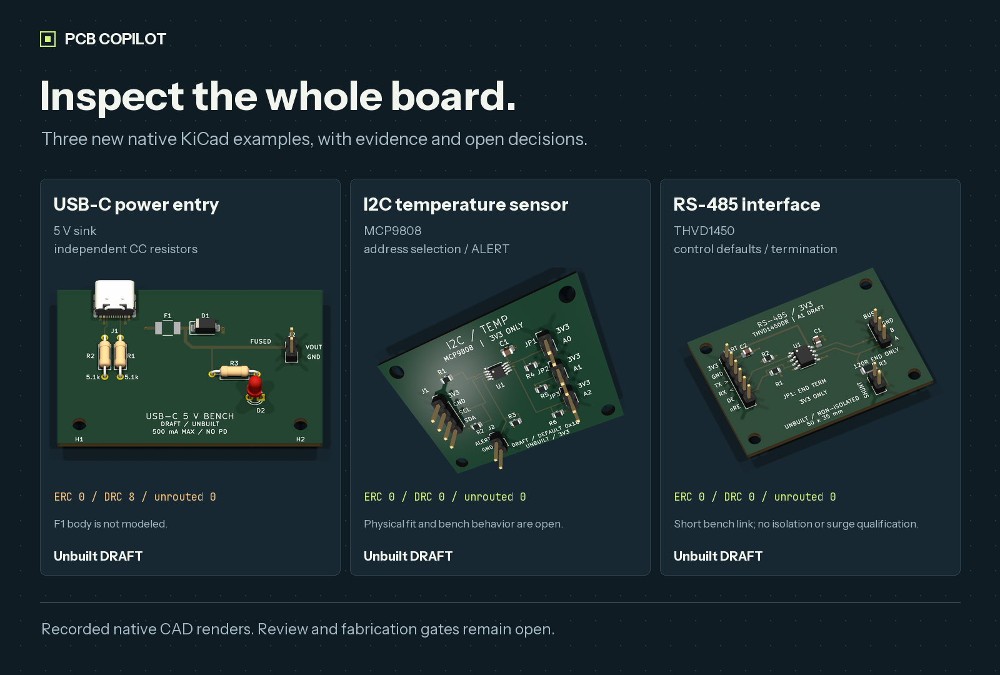
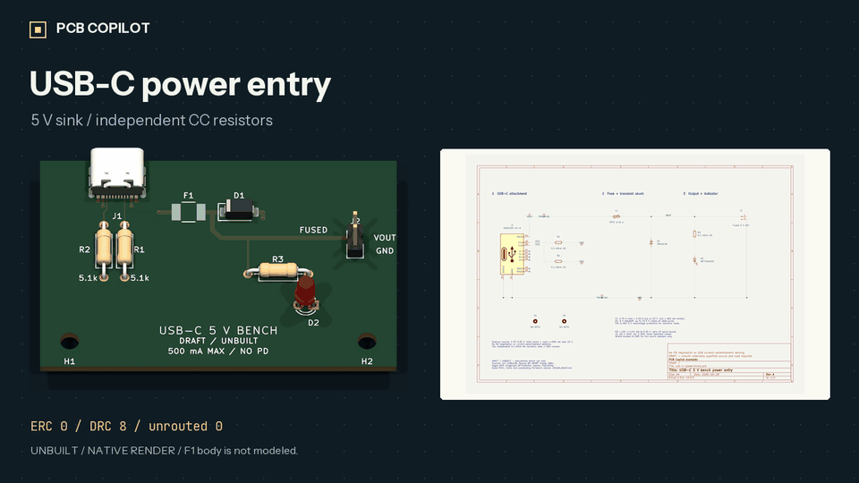

# PCB Copilot

**AI-assisted PCB engineering. Native KiCad. Evidence you can inspect.**

[](https://github.com/devkyber/PCB/actions/workflows/checks.yml)



Prepare scoped changes, check the candidate, inspect the native views, and apply
it explicitly. Keep manufacturer evidence and engineering decisions with the
design through to a gated manufacturing package.

**[Get started](docs/QUICKSTART.md)** · **[Explore the examples](examples/README.md)** ·
**[Make an offline handover](docs/HANDOVER.md)** · **[Read the workflow](docs/WORKFLOW.md)**

## Three new boards, with their working exposed

[](docs/media/examples-gallery.mp4)

*Recorded native CAD renders and schematic captures of unbuilt prototypes.
The USB-C example retains eight connector manufacturing findings and has no
PPTC body model. [Source and artifact hashes](docs/media/examples-manifest.json)
bind this gallery to the exact saved designs.*

| Example | Circuit and files | Current engineering boundary |
| --- | --- | --- |
| [USB-C power entry](examples/usb-c-power/README.md) | Independent CC resistors, PPTC, transient shunt and indicator. [Schematic](examples/usb-c-power/output/schematic.pdf) · [3D model](examples/usb-c-power/output/usb-c-power.glb) | Routed; ERC and pin-net parity pass. Eight connector annular-ring/NPTH-clearance findings block manufacturing review. No PD or current-advertisement detection. |
| [I²C temperature sensor](examples/i2c-sensor/README.md) | MCP9808 MSOP, eight selectable addresses and ALERT. [Schematic](examples/i2c-sensor/output/schematic.pdf) · [3D model](examples/i2c-sensor/output/i2c-sensor.glb) | Native ERC/DRC and parity pass. Bus behavior, physical fit, supplier assembly and human decisions remain open. |
| [RS-485 interface](examples/rs485-interface/README.md) | THVD1450, explicit control defaults and removable termination. [Schematic](examples/rs485-interface/output/schematic.pdf) · [3D model](examples/rs485-interface/output/rs485-interface.glb) | Native ERC/DRC and parity pass. Short bench-link prototype; isolation, surge/EMC and hardware behavior are unqualified. |

Each includes requirements, design basis, local libraries, exact manufacturer
archives, routed copper, native review views and a source-bound artifact
inventory. All remain **unbuilt DRAFTs**. The smaller
[GPIO indicator](examples/gpio-indicator/README.md) remains the first-run example.

## Get a first result

Use Git, **Python 3.11+** and
[uv](https://docs.astral.sh/uv/getting-started/installation/):

```sh
git clone https://github.com/devkyber/PCB.git
cd PCB
uv sync
uv run python tools/demo.py
```

The Python-only demo copies GPIO inputs into a new temporary directory, checks
status and archived bytes, and exercises the actual missing-preview rejection.
It prints an inspectable report, transcript and exact command logs while
preserving the saved source. Native ERC/DRC is separate.

Try a larger example with `--project examples/rs485-interface`. With **KiCad 10**
and its `pcbnew` Python bindings installed:

```sh
uv run pcb-copilot doctor
uv run python tools/demo.py --project examples/rs485-interface --full
```

A completed review with blockers returns **1** and preserves its findings.
[Quickstart](docs/QUICKSTART.md) covers setup, exit meanings and discovery.

## Hand an engineer an inspectable review

```sh
uv run pcb-copilot report examples/i2c-sensor --output NEW_EXTERNAL_DIRECTORY
uv run pcb-copilot verify-report NEW_EXTERNAL_DIRECTORY --project examples/i2c-sensor
```

Open the generated `index.html` offline. It includes every native schematic
page, assembly and mirrored copper views, the full review, check scopes and
source hashes. Filter findings, enlarge a view, and download the embedded vector
PDF. The packet's manifest also binds the original artifacts.

Verification runs without KiCad and distinguishes intact packet bytes from
whether the current project still matches. Viewing or verifying creates no
approval. See [the handover guide](docs/HANDOVER.md) and the recorded
[GPIO](docs/demos/gpio-review/index.html),
[sensor](docs/demos/i2c-review/index.html),
[RS-485](docs/demos/rs485-review/index.html) and
[USB-C](docs/demos/usb-c-review/index.html) packets.
Download the HTML to run it; GitHub displays its source.

## Inspect a successful change and a rejected stale apply

```sh
uv run python tools/demo_change.py
```

This prepares a real successful preview, changes the external candidate to
exercise stale-apply rejection, then creates a fresh preview. Inspect every
printed PDF page and use its exact hash-bound resume command to apply the
title-block revision to the disposable copy. Native electrical inventories,
PCB bytes and original source hashes are compared.
[The completed proof](docs/media/change-proof.md) records the actual
preview → stale rejection → fresh preview → reviewed apply sequence.

The [fault evaluation](docs/EVALUATION.md) tests corrupted evidence, changed
footprint geometry/model bytes, part identity, and independent candidate/source/
rule changes after genuine native previews:

```sh
uv run python tools/evaluate.py
uv run python tools/evaluate.py --native
uv run python tools/check_examples.py
```

Each case records its actual interface, diagnostic, exit and preservation
hashes. Native cases are explicitly skipped in quick mode. The example checker
verifies archives, selected-part coverage, footprint lineage and recorded
artifact identities; it does not rerun native qualification.

## Why this pipeline

| Engineering need | Implemented behavior |
| --- | --- |
| Preserve engineer-edited CAD | Start with saved native files. Scoped candidates preserve unrelated objects, UUIDs and routed copper. |
| Check where a part came from | Archive exact source bytes and verify selected MPNs, pad maps and local footprint/model receipts. |
| Inspect before installing | Preview with native-tool checks. Apply must match the current successful preview and all bound inputs. |
| Make review portable | Generate an offline handover with native views, complete findings and explicit check limits. |
| Keep decisions current | Bind named human decisions to CAD, requirements, rules and evidence; changed inputs invalidate them. |
| Preserve output during publication | Recheck sources and publish complete packages transactionally. Reject linked publication paths and retain recovery data when rollback cannot finish. |

```text
Saved KiCad + source evidence
             ↓
      Scoped candidate
             ↓
 Checks + native visual inspection
             ↓
       Explicit apply
             ↓
 Current human decisions → gated release
```

## Scope today

Native candidate preview/apply, evidence archive verification, exact supplier
part import, fourteen registered review checks, portable handovers and gated
manufacturing export are implemented. Optional autorouting needs Freerouting
and compatible Java; a route remains a candidate for review.

Agents can operate the CLI. A packaged interactive copilot/MCP service is future
work. Intent generation proposes a redraw and does not merge later manual CAD
edits. Autonomous engineering and measured time savings remain unproven.

The geometric house-rule checker covers portions of **4 of 42** historical
rule sections. ERC, DRC, parity and source hashes establish their stated scope;
circuit choices, thermal/RF/mechanical behavior, bench work and release decisions
still require engineering review. See [limitations](docs/LIMITATIONS.md).

## Use it with your project

Start with [the new-board workflow](docs/WORKFLOW.md#start-a-new-board) and
`templates/project/`. For an existing design, save and close KiCad, prepare a
separate native candidate and preview before using the identical command with
`--apply`. The [complete workflow](docs/WORKFLOW.md) covers layout, supplier
assembly, sign-off and recovery.

Read [Rover PDB](projects/rover-pdb/README.md) and [TMS](projects/tms/README.md)
for those owner projects' recorded status. Their saved CAD and requested scope
remain separate from the educational examples. Frozen boards under
`tests/fixtures/boards` are regression inputs.

| Read | Purpose |
| --- | --- |
| [Quickstart](docs/QUICKSTART.md) | Setup and first useful result |
| [Example catalog](examples/README.md) | Circuits, assumptions and native artifacts |
| [Handover](docs/HANDOVER.md) | Generate and verify offline review packets |
| [Workflow](docs/WORKFLOW.md) | Preview, apply, review and release |
| [Architecture](docs/ARCHITECTURE.md) | Ownership and implementation boundaries |
| [Design rules](docs/DESIGN_RULES.md) | Drawing, layout and review conventions |
| [Fault evaluation](docs/EVALUATION.md) | Reproduce the declared regression cases |
| [Roadmap](docs/ROADMAP.md) | Next capabilities and acceptance evidence |
| [Media sources](docs/media/README.md) | Reproduce the images and video |

If the workflow is useful, a star helps other engineers discover it.
