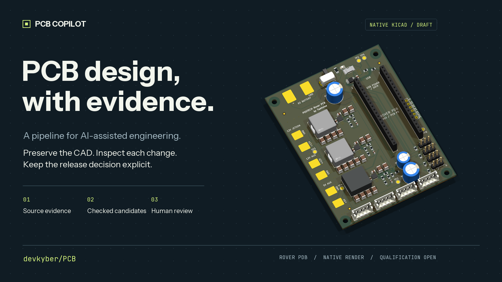
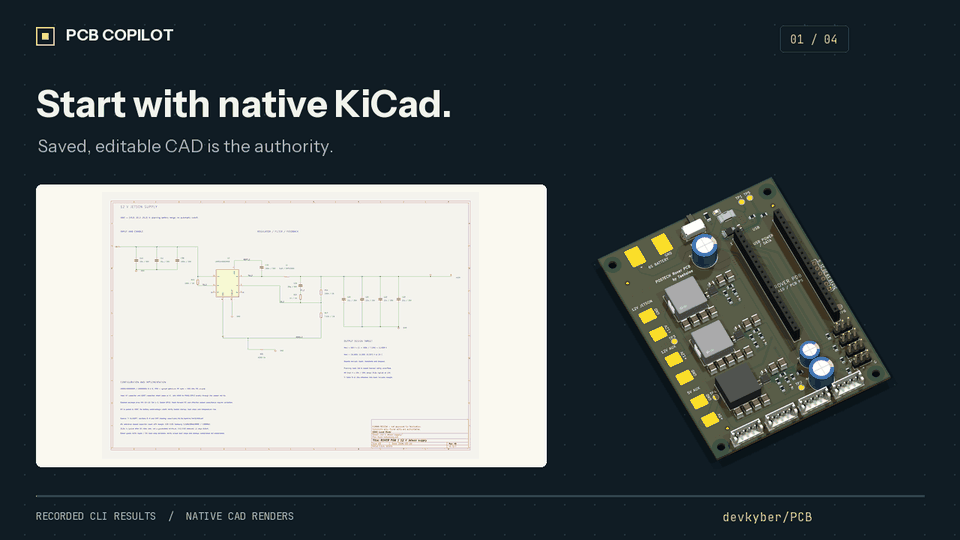
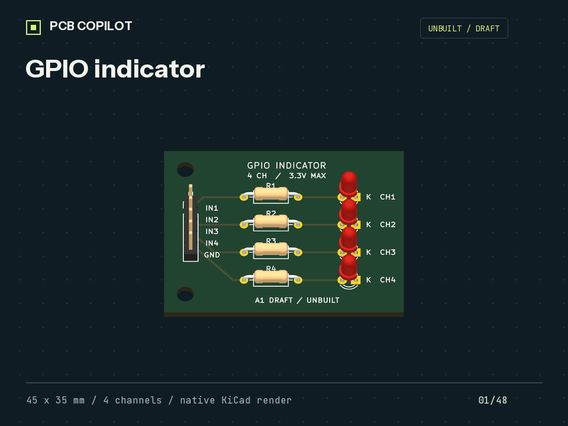
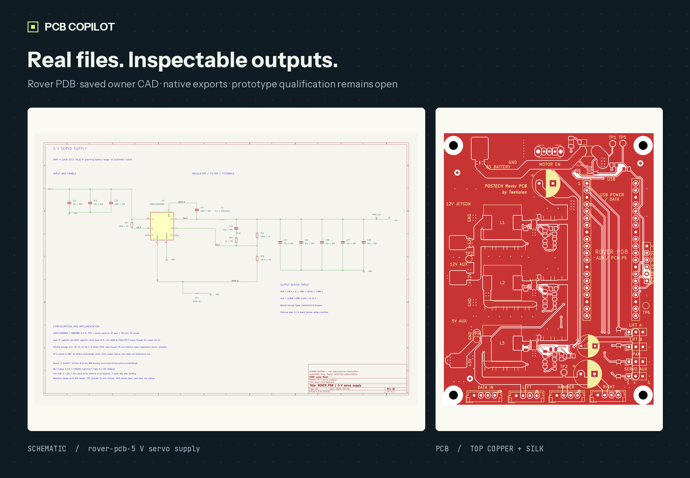

# PCB Copilot

**AI-assisted PCB engineering. Native KiCad. Evidence you can inspect.**



Prepare scoped changes to real KiCad projects, check the candidate, inspect the
results, and apply it explicitly. Keep source evidence and engineering decisions
with the design, through to a gated manufacturing package.

**[Get started](docs/QUICKSTART.md)** · **[Watch the walkthrough](docs/media/workflow.mp4)** ·
**[Read the workflow](docs/WORKFLOW.md)** · **[See the roadmap](docs/ROADMAP.md)**

## See what it actually does

[](docs/media/workflow.mp4)

*16-second animated walkthrough of recorded CLI results and native CAD renders.
This is a guided tour, not a screen recording or a successful-edit demonstration.
The full Rover run reported 12/14 checks passing; datasheet coverage and unsigned
human decisions blocked release. [Recorded results](docs/media/demo-results.json)
and [source/output hashes](docs/media/manifest.json) make the scope inspectable.*

## Why this pipeline

| What you need | What PCB Copilot does |
| --- | --- |
| Keep an existing engineer-edited design | Start from saved native CAD. Scoped candidates preserve the rest of the design; old generation recipes do not override owner edits. |
| Know where a part or decision came from | Archive exact source bytes and provenance; verify selected part identities and local footprint receipts. |
| Inspect a change before installing it | Preview candidates with connectivity, geometry and native-tool checks. Apply must match the current successful preview. |
| Keep approval tied to the current revision | Bind human decisions to CAD, requirements, rules and evidence. Changed inputs invalidate old decisions. |
| Publish a complete fabrication package | Rerun review and export Gerbers, drills, BOM, positions and provenance together; preserve the previous package if publication fails. |

```text
Saved KiCad + source evidence
            ↓
     Scoped candidate
            ↓
 Checks + rendered inspection
            ↓
       Explicit apply
            ↓
 Current human decisions → gated release
```

## Try it on a real board

Use **Python 3.11+**, [uv](https://docs.astral.sh/uv/getting-started/installation/)
and **KiCad 10**. Native review also needs a Python runtime that can import
KiCad's `pcbnew`; [setup and troubleshooting](docs/QUICKSTART.md) explain discovery.

```sh
git clone https://github.com/devkyber/PCB.git
cd PCB
uv sync
uv run pcb-copilot doctor
uv run pcb-copilot status projects/rover-pdb
uv run python tools/demo.py
```

The quick demo copies declared Rover inputs to a new temporary directory, runs
status and archive verification, and exercises the actual missing-preview guard.
It prints the path to a Markdown report, machine-readable transcript and exact
command logs. The source board stays untouched. **It does not run native ERC/DRC.**

Add `--full` to run the registered native review checks on that disposable copy:

```sh
uv run python tools/demo.py --full
```

A blocked review returns exit code **1**, with its findings preserved. This is
expected when evidence or current human decisions are incomplete. Demo completion
and a clean individual check do not grant fabrication approval.

## Start with a small, complete example

[](docs/media/gpio-turntable.mp4)

The [GPIO indicator](examples/gpio-indicator/README.md) is a new **45 × 35 mm,
two-layer educational board** with four independent 3.3 V LED channels. It has
one readable sheet, routed copper, project-local libraries, archived manufacturer
sources and a [native 3D model](examples/gpio-indicator/output/gpio-indicator.glb).
It is an **unbuilt DRAFT**; physical fit and bench behavior remain unqualified.

The scoped-change demo runs a real **successful preview → stale-apply rejection →
fresh preview → reviewed apply** in an external copy. Only a title-block revision
changes; native electrical inventories and PCB bytes are compared.

```sh
uv run python tools/demo_change.py
```

It stops at the fresh preview and prints the rendered PDF and exact hash. Inspect
every page, then use the printed resume command to apply that exact candidate to
the disposable copy. This author inspection is separate from owner fabrication
sign-off. [Recorded proof](docs/media/change-proof.md) shows a completed run.

## Inspect the native design



The design remains an editable schematic hierarchy and PCB. The images above are
native exports, and the hero uses a **3D render**. Physical fit, thermal performance
and bench qualification remain separate engineering work.

| Example | What to inspect | Current scope |
| --- | --- | --- |
| [GPIO indicator](examples/gpio-indicator/README.md) | [Native project](examples/gpio-indicator/gpio-indicator.kicad_pro), [schematic](examples/gpio-indicator/output/schematic.pdf), [review](examples/gpio-indicator/docs/review/A1_REVIEW.md) | Small routed educational example. Native checks pass; assembly qualification and human release decisions remain open. |
| [Rover PDB](projects/rover-pdb/README.md) | [Native project](projects/rover-pdb/rover-pdb.kicad_pro), [schematic](projects/rover-pdb/rover-pdb.kicad_sch), [PCB](projects/rover-pdb/rover-pdb.kicad_pcb), [pipeline audit](projects/rover-pdb/docs/review/PIPELINE_AUDIT.md) | Owner-edited, routed two-layer power board. Development is closed; engineering qualification and fabrication approval remain separate. |
| [TMS](projects/tms/README.md) | [Native project](projects/tms/tms.kicad_pro), [source evidence](projects/tms/evidence/index.yaml), [design basis](projects/tms/DESIGN_BASIS.md) | Recreated schematic; PCB and qualification pending. Its project README is the revision/status authority. |

## What works today

| Capability | Status and boundary |
| --- | --- |
| Native schematic and PCB candidates | Implemented: checked preview/apply, parity and stale-input protection. Visual inspection remains required. |
| Evidence and exact supplier-part lookup/import | Implemented: archived bytes, provenance, C-number/MPN identity. Coverage does not prove interpretation or suitability. |
| Current review and transactional release | Implemented: fourteen registered checks plus current named human decisions. Each check reports its own scope. |
| Toolchain diagnostics and disposable demo | Implemented: `doctor`, recorded command results and input-preservation hashes. |
| Intent-based schematic/placement generation | Available as a proposal/redraw path. It does not merge later manual CAD edits or establish engineering correctness. |
| Optional autorouting | Requires Freerouting and compatible Java. A route remains a candidate for review. |
| Agent integration | Agents can operate the CLI. A packaged interactive copilot/MCP service is future work. |
| Autonomous engineering and measured time savings | Unproven. See [limitations](docs/LIMITATIONS.md) and the [evaluation roadmap](docs/ROADMAP.md). |

The geometric house-rule checker covers portions of **4 of 42** historical rule
sections. ERC, DRC, archive verification and parity are useful scoped checks;
they cannot decide every circuit choice, return path, RF, thermal, mechanical or
failure-mode question.

## Bring your KiCad project

Start with [the new-board workflow](docs/WORKFLOW.md#start-a-new-board) and
`templates/project/`. Declare the saved CAD, requirements, evidence and review
profile. Use [the native JLCPCB geometry template](templates/jlcpcb-2layer-1oz/meta/info.html)
when its dated process assumptions fit your board.

For an existing design, save and close KiCad before external application, prepare
a separate native candidate, and preview before using the identical command with
`--apply`. The [complete workflow](docs/WORKFLOW.md) covers hierarchy, layout,
supplier assembly checks, sign-off and interrupted-operation recovery.

## Go deeper

| Read | For |
| --- | --- |
| [Quickstart](docs/QUICKSTART.md) | Setup, first useful result and troubleshooting |
| [Workflow](docs/WORKFLOW.md) | Supported commands and the preview/apply/release lifecycle |
| [Architecture](docs/ARCHITECTURE.md) | Implementation boundaries, ownership and retention |
| [Design rules](docs/DESIGN_RULES.md) | Schematic readability, physical layout and review conventions |
| [Limitations](docs/LIMITATIONS.md) | What checks establish and what needs engineering judgment |
| [Roadmap](docs/ROADMAP.md) | Next capabilities and the evidence needed to claim them |
| [Media sources](docs/media/README.md) | Reproduce the images and video; inspect captured results |

The shared CLI lives in `src/pcb_copilot`. The retained KiCad adapter lives in
`packages/kicad-claude-mcp`; its historical name does not imply a running MCP
server. Frozen boards under `tests/fixtures/boards` are regression inputs, never
active projects to develop or restore.

If the workflow is useful to you, a star helps other engineers discover it.
