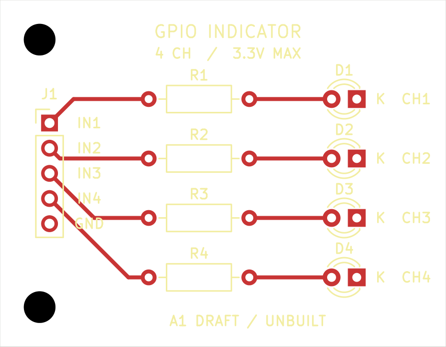

# Four-channel GPIO indicator

An **unbuilt educational DRAFT** for trying PCB Copilot on a complete, small KiCad design. Four independent 0 to 3.3 V inputs drive four red LEDs through 1.1 kOhm resistors. The 45 x 35 mm board has two copper layers, through-hole components, two mounting holes, project-local libraries and all three package models.



Open [gpio-indicator.kicad_pro](gpio-indicator.kicad_pro) in KiCad 10, or inspect the [schematic PDF](output/schematic.pdf), [schematic image](output/schematic.png), [assembly drawing](output/assembly.png), [front copper](output/top-copper.png) and [mirrored underside](output/bottom-copper.png). The [GLB model](output/gpio-indicator.glb) is a native CAD visualization; it does not establish actual component fit.

From the repository root:

```sh
uv run pcb-copilot doctor
uv run pcb-copilot status examples/gpio-indicator
uv run pcb-copilot research examples/gpio-indicator --verify
uv run pcb-copilot research examples/gpio-indicator --verify-schematic-parts
uv run pcb-copilot review examples/gpio-indicator
```

The last command deliberately returns **exit 1**: supplier assembly rotation contracts and all five human review decisions are absent. Native ERC and DRC are clean, connectivity and forward-annotation links agree, and the independent dated JLCPCB geometry check passes. These results are scoped machine checks, not fabrication approval or measured performance. See the [saved review](output/review-a1.json) and [author inspection record](docs/review/A1_REVIEW.md).

J1 pins 1 through 4 are IN1 through IN4; pin 5 is GND. It has no power pin. With a 3.3 V input and initial 1% resistance tolerance, the calculation gives at most **3.031 mA per channel**, taking no credit for LED forward voltage. That loading must suit the actual controller's per-pin and aggregate drive limits. Actual brightness, current, fit, assembly and external-controller behavior remain unqualified.

The resistor was deliberately chosen as 1.1 kOhm: 1 kOhm at its negative 1% tolerance would allow a 3.333 mA zero-Vf bound. The [requirements](REQUIREMENTS.md) and [design basis](DESIGN_BASIS.md) state the assumptions and scope. This example has no ESD protection, isolation, level conversion, voltage regulation or approval for an application.

Exact manufacturer PDF bytes are in [evidence](evidence/index.yaml). The [library receipt](libs/PROVENANCE.json) binds official KiCad footprint copies, pad functions, manufacturer evidence and local model bytes to their hashes. The local footprint files change only model URIs. Board instances use wider silkscreen strokes to meet the workspace baseline; numbered pad geometry is unchanged. Generic package models are visualization aids.

The saved native CAD is authoritative. A construction script must not overwrite later edits. Use a separate copy for experiments and the [shared candidate workflow](../../docs/WORKFLOW.md) for checked updates. No owner board or frozen test fixture was modified to create this example.
