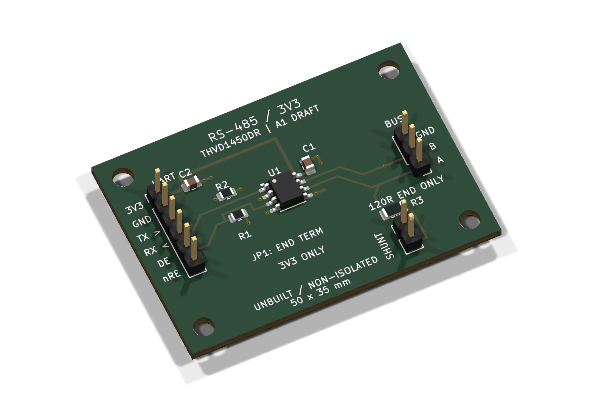

# 3.3 V RS-485 interface

**Unbuilt educational DRAFT.** A native KiCad UART-to-half-duplex-RS-485 board
with a TI THVD1450DR, independent driver/receiver controls and removable end
termination. No isolation, industrial ESD/surge/EMC, physical-fit or link-speed
qualification is claimed. Nothing here is approval to fabricate or energize.

[Follow the bring-up guide](BRINGUP.md) for connector wiring, removable
termination, default receive, local echo and the exact DE/nRE sequence around the
last UART stop bit. Run these offline tools from the repository root; they access
no serial port or GPIO:

```sh
python examples/rs485-interface/bringup.py budget --supply 3.3 --terminations 2
python examples/rs485-interface/bringup.py sequence --bytes 4 --suppress-echo
```

The termination-only model exposes missing/excess termination and the conservative
current boundary at 3.6 V. Its serialization estimate never replaces the actual
controller's hardware TX-complete flag. Tests and retained demo output contain no
measured hardware result.



| Property | Design |
| --- | --- |
| PCB | 50 x 35 mm, two layers, four 3.2 mm NPTH mounting holes |
| Supply/logic | External 3.3 V nominal, project input 3.0-3.6 V |
| Transceiver | THVD1450DR, SOIC-8; no MCU or firmware included |
| J1 | 1=3V3, 2=GND, 3=TXD into board, 4=RXD out, 5=DE, 6=nRE |
| J2 | 1=A, 2=B, 3=GND; names follow TI |
| Default | R1/R2 10 kOhm: driver disabled, receiver enabled when host floats |
| Termination | R3 120 Ohm/1%/0.25 W; JP1 shunt only at a physical cable end |
| Accessory | Samtec SNT-100-BK-G shunt, separate off-board item; not installed in the native 3D model |

Use compatible 3.3 V host logic, a shared reference ground and an appropriate
short twisted pair for initial bench evaluation. Confirm the other node's A/B
convention. Fit termination at both physical cable ends as required by the cable;
remove JP1 at middle nodes. Host, supply, cable and remote node remain unselected.
115200 baud is an initial test target, not a demonstrated rating. Fast edges
still need proper line treatment even at low baud rates.

Open [the native project](rs485-interface.kicad_pro),
[schematic](rs485-interface.kicad_sch) and [PCB](rs485-interface.kicad_pcb).
The saved CAD is authoritative; authoring scratch files are ignored and must
never be replayed over later owner edits. Native footprint UUID links preserve
ordinary forward annotation. See [requirements](REQUIREMENTS.md),
[design basis](DESIGN_BASIS.md), [reference comparison](REFERENCE_REVIEW.md),
[source index](evidence/index.yaml) and [library provenance](libs/README.md).

Inspect [the schematic PDF](output/schematic.pdf),
[front copper](output/front.png), [mirrored back](output/back.png),
[assembly drawing](output/assembly.png), [native model](output/rs485-interface.glb)
and [author inspection](docs/review/A1_REVIEW.md). Every page and board view
needs actual visual review; an export or clean ERC/DRC alone is insufficient.

From the repository root:

```sh
uv run pcb-copilot research examples/rs485-interface --verify
uv run pcb-copilot research examples/rs485-interface --verify-schematic-parts
uv run pcb-copilot review examples/rs485-interface --format json
```

The [saved review](output/review.json) records its actual checks and remaining
blockers. Missing exact supplier assembly contracts and unsigned human decisions
must remain visible. No owner sign-off, placement approval, hardware test or
fabrication release is supplied. [Source/output hashes](output/SOURCE.json)
identify the particular retained renders and software results.
