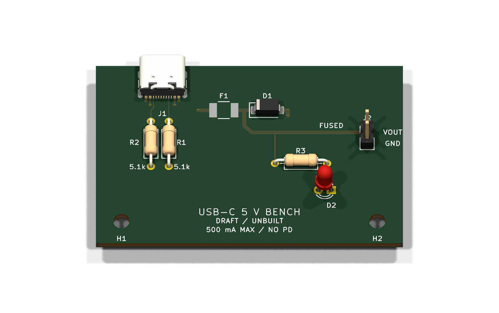

# USB-C 5 V bench power entry

An **unbuilt educational DRAFT** with independent CC pull-downs, a resettable
fuse, a unidirectional TVS, a power LED and a two-pin output. The fresh
60 × 40 mm two-layer board is fully routed, but **eight connector manufacturing
findings remain unresolved**. It is a useful example of the pipeline reporting
a real blocker instead of treating an official footprint as fabrication approval.



Open [usb-c-power.kicad_pro](usb-c-power.kicad_pro) in KiCad 10, or inspect the
[schematic PDF](output/schematic.pdf), [schematic image](output/schematic.png),
[assembly drawing](output/assembly.png), [front copper](output/top-copper.png),
[mirrored underside](output/bottom-copper.png) and [native GLB](output/usb-c-power.glb).
F1 intentionally has no 3D body model. The other package models are exact
archived KiCad library models; none qualifies the selected part's physical fit.

From the repository root:

```sh
uv run pcb-copilot status examples/usb-c-power
uv run pcb-copilot research examples/usb-c-power --verify
uv run pcb-copilot research examples/usb-c-power --verify-schematic-parts
uv run pcb-copilot review examples/usb-c-power --format json
```

The review returns **exit 1**. The dated [actual review](output/review-a.json)
reports clean native ERC, exact schematic/PCB part/pin-net/UUID parity and zero
unrouted connections. It retains four J1 shell annular-ring errors and four
GND-pad/peg-hole clearance errors under the unchanged workspace rules. The
supplier assembly contracts, F1 body model and all six human decisions are also
unresolved. No rule was relaxed, finding
excluded, reference waiver added, or human approval invented.

Use only a separately qualified **4.75–5.25 V bench source and at most 500 mA
total board-plus-load budget near 23 °C**. Passive 5.1 kOhm CC pull-downs do not
negotiate PD or establish permission to draw 500 mA from every USB port. There
is no source-current detector, active current limiter, reverse blocking,
output regulator or inrush controller. Never backfeed J2. Its pin1 is VOUT and
pin2 is GND; VOUT includes fuse/connector/copper voltage loss.

The selected 0.75 A hold PPTC is **not a 500 mA current limiter**. The TVS has
6 V standoff and a listed 10.3 V maximum clamp at its specified pulse test;
it does **not** provide 5 V overvoltage protection for sensitive loads. Start
with a non-sensitive resistive dummy load and current-limited source. Reflow
is required for the selected PPTC assembly plan. The [design basis](DESIGN_BASIS.md)
records exact manufacturer limits, calculations, pad mapping and open tests.

[Evidence](evidence/index.yaml) archives all selected purchased-part PDFs,
the dated USB integration reference and a pinned Adafruit open-hardware
schematic/board pair for comparison. The [reference review](REFERENCE_REVIEW.md)
states the adopted pattern and differences. The [official-copy receipt](libs/PROVENANCE.json)
and separate [Bourns drawing receipt](libs/footprint-provenance.yaml) pass their
scoped lineage checks. Bourns' recommended PPTC lands differ from generic
1812 pads, so F1 uses an explicitly derived footprint. The connector's required
contact lands were preserved, leaving its manufacturing conflict visible.

[SOURCE.json](output/SOURCE.json) binds the retained outputs, exact saved
inputs, native version and raw command logs. Checks and renders ran on an
external disposable copy, with source and snapshot input hashes unchanged.
The [author review](docs/review/A_REVIEW.md) records actual page and layout
inspection; it is not an owner sign-off or a hardware qualification.

Saved native CAD is authoritative. Use a separate copy for experiments and
the [shared candidate workflow](../../docs/WORKFLOW.md) for revisions. No owner
board, existing example CAD or frozen test fixture was used as this design's
starting circuit or layout.
