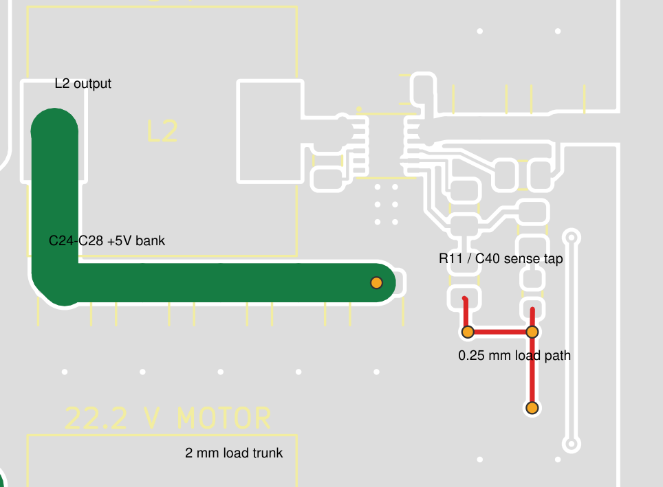
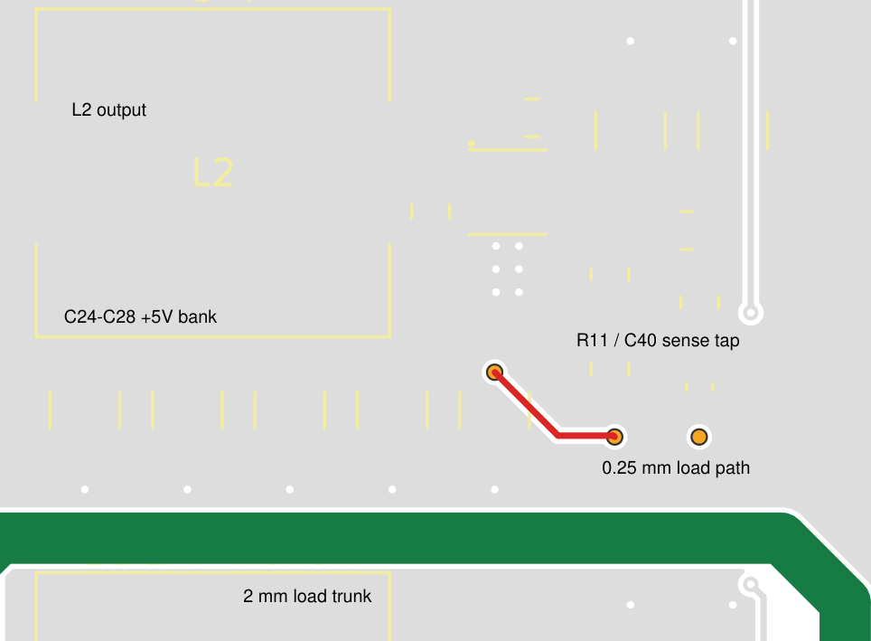

# PCB verification — updated 2026-10-04

## Current P5 / A10: sockets, widths, pad vias and fuse removal

The owner requested socket models, a Pico 2 fit check, useful vias near solid
solder pads, power-width inspection and F1 removal. KiCad was confirmed closed
and no editor/manager process or lock was present at application. P5/A10 was
installed through a successful matching native `update-schematic --candidate
... --pcb ... --apply`, using the saved P4 as its source. No generator or
autorouter reconstructed the board. The shared local socket library changes
only its two generic official KiCad STEP model associations.

Installed PCB SHA-256:
`4cfc5eb7b2b986b471b8c3e80f0de72ce629481680a0ee062e0dff92b51660fe`.
Installed project settings SHA-256:
`b88f5b7ef1f1badfab83a8378abcf14b01ba1b452cda6bceafc9fc8f5188df70`.
The detailed changes, source binding and original external backup are recorded
in [p5-pad-socket-review.json](records/p5-pad-socket-review.json).

| Applied change | Verification scope |
| --- | --- |
| Two female socket models on SKT1 | The forty native pads are unchanged. Generic 1x20 STEP bodies are at 17.78 mm row spacing; the selected LXWCONN drawing remains the dimensional authority. |
| Pico 2 fit | All forty pad locations match the official drawing: 2.54 mm pitch, 17.78 mm rows, 48.26 mm pin span. The 21 x 51 mm body is clear in plan view. Actual header/contact engagement and USB cable fit are not established. |
| Six widened input/VBAT segments | Native positions and endpoints remain, with 3-4 mm widths where clearance allows. A short 2.8 mm shunt approach remains for Kelvin spacing. Existing output routing and P4's separate 5 V force/sense repair are preserved. |
| 48 new useful vias | 0.60/0.30 mm, tented on both faces, outside solder/paste lands; 42 beside wire pads and six beside converter grounds. Every new via intersects useful same-net copper on both layers after refill. Four bottom positive patches spread pad heat/current. |
| F1 removed | Input symbol, holder and its hole are absent; a 4 mm front bridge connects P1 to RS1 on BAT_SWITCHED. Old VBAT_FUSED is merged into that net; the unused PDB_Fused routing class/pattern are removed. No onboard fuse remains. |
| Native ownership | All retained footprints' placement, pad geometry, values and sourcing are preserved. Five child sheets are byte-identical; only input-monitor and the root overview change. P2/P3 remain 12 V. |

Both preview DRC runs and both apply DRC runs report **0 errors, 0 warnings and
0 unconnected items**. Native circuit/PCB parity and placement pass. The
Rover-specific check reports **0 ERC errors/warnings**, no selected-component,
critical-connection or footprint-pin failures and no unassigned footprints.
Historical intent still describes F1 and is explicitly advisory; the current
native netmap and adopted-circuit checks govern the active design.

The native power-path fault check passes **19/19** after removing power-net
tracks narrower than 0.8 mm in memory. P4 passes 20/20 as a control; F1 removal
combines two paths into one. This detects reliance on thin sense copper, not
ampacity or thermal performance. The installed hash matches the checked
candidate. There are 91 footprints, 482 tracks, 167 vias and 14 zones; all
tracks/vias are unlocked. Ground and new pad patches use direct/full pad
connections, not thermal spokes.

Full review passes ten machine checks; its only blocking result is the five
unsigned human decisions. Five routing-setting advisories describe the retained
2.4 mm rail defaults versus short 3 mm pad spurs, the absent 3 mm preset, and
BAT_SWITCHED's 3.5 mm default versus some 4 mm copper. These are mixed branch
widths, not DRC or ampacity results. Connected-track mode can inherit the actual
width; enter 3 mm explicitly when maintaining those pad spurs. The existing
class values and other routing defaults are intentionally preserved.

All seven schematic pages, all four PCB PDF pages and the oblique 3D assembly
were visually inspected. The socket bodies are visible. Generic display models
and a partially unavailable STEP assembly do not certify purchased-part or USB
fit. Current-limited bring-up, simultaneous-load temperature, regulator
transients, motor energy and external battery protection remain engineering
checks. Five human release decisions remain unsigned. No manufacturing package
or order was created.

## Historical P4: reviewed repairs applied

The owner authorized applying the reviewed changes and confirmed KiCad was
saved and closed. P4 was installed through a successful, matching
`update-layout` preview/apply. The source was the exact owner save reviewed
below, SHA-256 `8601ebaf26ddbabb79a46fb83d3d9e3f11491b84755aa522b27aeb6741d9eb84`.
No historical layout generator or autorouter was used.

Installed PCB SHA-256:
`02312e6093be19c3b4c89f58daeb52bf62498f8ec676f714b12679a12d6aa11e`.
Full transaction, original backup location and independent check results:
[p4-repair-review.json](records/p4-repair-review.json).

| Applied change | Result |
| --- | --- |
| Restore the 5 V force connection | Four parallel 0.60/0.30 mm vias outside solder lands and a 2 mm back-layer link connect the L2/output bank to the load backbone. |
| Separate output sensing from load current | Removed two narrow feedback-to-load-bus segments and two redundant vias. R11/C40 retain a separate output-bank sense takeoff. |
| Repair silkscreen | Moved `12V AUX` clear of TP3. Moved the bottom-edge connector pin legends to B.SilkS, 1 mm high and inside the board, using `D+`, `D-` and `VM`; repeated the connector function names on the back. Front function names remain. |
| Correct assembly metadata | SKT1 is excluded from automatic BOM/position files and remains fitted, not DNP. Two sockets plus the Pico/header assembly are hand-fitted according to [BOM notes](../design/BOM_NOTES.md). |
| Align mounting clearance | Recentered the two H1 screw keepouts by about 0.069 mm to match the actual owner-placed hole. No mounting hole or component moved. |
| Reconcile documentation | Current requirements, basis and review profile now describe the saved 78.5 × 100.5 mm outline and actual mounting coordinates. Historical P2/P3 geometry remains clearly historical. |
| Refresh review drawings | The [four-page PCB PDF](../../output/pdf/rover-pdb-pcb-review.pdf) and native SVGs match the installed P4 PCB/settings. The back view is mirrored to show the physical underside and readable pin labels. |

**Verification:** both preview DRC runs and both apply DRC runs report
**0 errors, 0 warnings and 0 unconnected items**. Native schematic/PCB parity
and placement checks pass. An independent reviewer reproduces the old 15/20
power-path result as a negative control, then obtains **20/20** for P4.
The installed PCB hash exactly matches that independently tested candidate.
All 92 component positions, pad geometry/nets, values, references and supplier
fields are preserved; SKT1's assembly-exclusion flags are the only footprint
attribute change. All seven schematic files, footprint libraries and project
routing settings remain byte-identical. The board has 477 native track
segments and 119 vias, all unlocked. The export-provenance checks pass 7/7.
All four rendered PDF pages and the repaired front/back copper were inspected.

The old KiCad lock files persisted after the user's close confirmation.
Windows process checks found no KiCad editor/manager processes and their
host/user matched this machine; those stale locks were moved into the external
backup before the normal guarded apply. No live editor lock was discarded.

**Remaining scope:** this repair does not select a replacement switch,
engineer a motor braking clamp, claim physical USB/socket fit, or establish
thermal/load-step performance. The optional tighter feedback-divider placement
and shorter switch-control routing remain optimization opportunities; current
component placement was deliberately preserved. Existing thermal vias remain
outside the exposed-pad paste lands. Motor-energy handling and the five current
human release decisions remain open. A complete STEP assembly export still
cannot include the existing VRML models. No manufacturing package or order was
created. These limits are not reported as passed by the routing repair.

## Historical owner save: pre-order review before P4 repair

**Disposition: repair the 5 V power route before ordering.** Ordinary DRC is
clean of errors, but the dedicated connection from the 5 V output capacitor
bank to its load-distribution copper is missing. A minimal checked candidate
is prepared; it is **not applied** to the owner's saved PCB. No schematic,
PCB, project settings or supplier selection was changed during this review.

Reviewed PCB SHA-256:
`8601ebaf26ddbabb79a46fb83d3d9e3f11491b84755aa522b27aeb6741d9eb84`.
Project-settings SHA-256:
`2eb2b81dc4d1fcbf7830579cf301a21b61c14440832b31146e028f071b11a00b`.
The native title still says P3. This section supersedes earlier P3 pass claims
for the latest owner-edited geometry. Full current input hashes, machine
results and repair evidence are in [preorder-review.json](records/preorder-review.json).

### Findings and practical corrections

| Priority | Finding | Required action |
| --- | --- | --- |
| Before order | **5 V load current runs through thin sense copper.** C24–C28 reach P4, C2 and J2/J3/J4 only through about 12.93 mm of 0.25 mm trace and three individual via transitions. | Restore a dedicated broad power route; retain a separate light-current output-sense connection. Checked candidate described below. |
| Before order | **Motor energy handling is unresolved.** U4 has no verified arrangement for returned motor energy or a charged output when input power collapses. This is an existing circuit question, not a new routing defect. | Resolve the permitted motor voltage and U4 output-above-input behavior with a justified energy/protection design or an explicitly limited prototype test plan. A clean DRC cannot close this item. |
| Before assembly order | **SKT1 is a composite module/socket interface.** A generic BOM/CPL export produces one SKT1 item without an LCSC number, although the assembly needs two sockets and a Pico/header assembly. | Explicitly mark the assembly as hand-fitted in the ordering plan, or represent its separately fitted parts correctly in the assembly outputs. Do not let part matching guess. Existing purchases are listed in [BOM notes](../design/BOM_NOTES.md). |
| Before order | **Switch and USB fit need a final mechanical decision.** SW1 still uses OS102011MA1QN1; the Pico/socket assembly has no complete 3D model and the previous USB clearance rule area was removed. | Accept the exact fitted switch or change its footprint before fabrication. Check the actual USB plug, socket height and header engagement; R1/R2 in the approach do not alone prove a collision because the Pico is raised. |
| Drawing/label correction | **Actual board is 78.5 × 100.5 mm, with square corners and an irregular mounting-hole pattern.** Older design text says 80 × 100 mm. | Retain the owner's geometry unless deliberately changed; reconcile the final mechanical drawing and quote dimensions. Do not assume the earlier 100 mm price bracket. |
| Label correction | TP3's circle overlaps `12V AUX`; bottom connector pin legends crowd the board edge. | Move the overlapping text and give the bottom legends room inside the outline. Use `D+`/`D−` for data pins so bare `+`/`−` cannot be mistaken for power polarity. |
| Cleanup | A redundant +5 V via at (139.80119, 119.55) mm connects on the front but has no bottom connection. | Removed in the candidate. This warning is separate from the missing broad power connection. |

Coordinates here are absolute KiCad millimetres. In the saved PCB, follow the
thin +5 V route from C28 at (131.815171, 117.025), along B.Cu to
(136.5, 119.55), then F.Cu through the R11/C40 sense junction to
(139.8, 123.45). It finally reaches the 2 mm B.Cu distribution bus. The nets
are electrically continuous, which explains the zero-unconnected DRC result.
At nominal 35 µm copper, this thin trace alone is approximately 25 mΩ: about
61 mV drop and 0.15 W at the provisional 2.4 A load, before via losses.
These estimates are not an ampacity or temperature qualification.

The annotated native views show broad +5 V copper in green, narrow +5 V
copper in red and its vias in orange. The back view uses top-side coordinates.





### Prepared repair, not installed

Candidate SHA-256:
`4c8c0e9132c9843e63c2feff5dfe7e127e2861162fcf10c35c9c9e7092f1e229`.
Its recoverable working path is recorded in the JSON evidence. It starts from
this exact owner save and preserves all 92 footprints, their placement, pad
geometry, nets and fields, the outline, all existing retained copper, zone
definitions and board text. The seven schematics remain untouched.

The change adds four 0.60/0.30 mm vias to the broad L2 output leg, outside
solder lands, and three 2 mm B.Cu segments to the existing load backbone. It
removes the two narrow sense-to-backbone segments and two redundant vias.
R11/C40 retain a separate sense takeoff from the output capacitor bank.
Native filled front/back repair views were inspected. Fresh candidate DRC
reports **0 errors, 1 existing TP3 silkscreen warning, 0 unconnected items**.
The shared update preview also passes, including two independently invoked
DRC runs with those results and exact native pin parity. The independent
power-path check improves from **15/20 to 20/20**. A complete STEP assembly
export remains unavailable because some existing models are VRML; native
footprints and the inspected 2D/3D views remain available.

Application still requires the user's requested repair scope, closed KiCad
editors and the normal matching `update-layout` preview/apply. The candidate
is not an alternative active Rover project or a fabrication release.

### What was checked

| Check | Latest saved PCB result |
| --- | --- |
| Fresh seven-sheet ERC and Rover component/pin assertions | Pass; no ERC errors or warnings |
| Native schematic-to-PCB pin/net parity | Exact match; no pin errors |
| Zone-refilled DRC, two runs | Each: 0 errors, 2 warnings, 0 unconnected items |
| Placement, archived source integrity and netmap freshness | Pass within the pipeline's stated scope |
| Power-path fault test | **15/20 pass**; all five 5 V load paths fail |
| Routing editability | 476 native segments, 117 vias, none locked; no autorouting or regeneration used in this review |
| Source preservation | All reviewed CAD/settings inputs stayed byte-identical during review |
| Visual review | Current native assembly, front/back copper, three converter cells, shunt takeoffs and native 3D assembly inspected |
| Historical geometry comparison | `not_comparable` after owner moves; not counted as a pass |
| Human release decisions | 0/5 current signed decisions; none fabricated |

The power-path test removes power-net tracks narrower than 0.8 mm from an
unsaved, refilled copy and traverses native KiCad connectivity. Its purpose is
to detect loads relying on signal-size copper; **0.8 mm is a test threshold,
not a declared safe power-track width**. The battery/fuse/shunt paths, all
three converter input banks, both 12 V outputs and all motor outputs pass.
The prepared repair restores all five 5 V paths. This test does not determine
via current sharing, temperature rise or transient performance.

### Layout that should be preserved, and optional improvements

- **Preserve the RS1 Kelvin takeoffs.** The INA226 sense traces leave the inner
  shunt lands independently of the broad load-current connections. Battery
  present while INA226's USB-derived supply is absent is permitted by TI;
  this sequencing is not a fault.
- **Preserve the local converter loops.** C30/C31/C32 return directly to EP13
  through front copper; BOOT capacitors and SW-to-inductor paths are short,
  with no SW vias. Each AGND net-tie is beside its IC. Feedback returns do not
  carry output-capacitor current. These follow the topology in TI SLUSEP7
  §§9.5.1–9.5.1.2 and Figure 9-10.
- **Bring the feedback dividers closer to FB if another placement pass is
  made.** The FB pin-to-divider tap route is about 5.9 mm. It stays away from
  SW, so this is an improvement opportunity, not proof of instability.
- **Shorten unnecessary switch-control detours.** MOTOR_EN uses about 118.8 mm
  and four vias; SW_SUPPLY uses 77.8 mm and three vias. Their divider/pulldown
  remain local to U4 and define an OFF state. The switch's distant location
  accounts for part of the length.
- **Verify heat at simultaneous load.** Each IC has six ground vias outside
  its body rather than in EP13. This avoids untreated open holes in the paste
  land but provides a less direct thermal path. TI's four-layer EVM temperature
  results do not qualify this two-layer, 1 oz board. Do not add open via-in-pad
  holes merely to resemble the EVM.

### What remains before an order, and after a first prototype

The physical assembly and purchasing plan must identify all manually fitted
items, the separate fuse insert, the actual switch, socket/header stack and
harness. The current main fuse does not establish protection of individual
3 A JST branches; verify the intended harness and fault-current limits. The
planned 1.4/1.4/0.7 A motor branch loads do not by themselves overload those
contacts. No current stock reservation, assembler rotation approval or
finished Gerber/BOM/CPL package is claimed here.

TI SLUSEP7 §9.3 requires avoiding output above input. The motor bank's nominal
260 µF stores only about **7–11 mJ** between its static design voltage and
the project's 24 V ceiling; this is an upper screening estimate before ceramic
derating, not a measurement of braking energy. Resolve the actual mechanical
energy and allowable voltage rather than assuming the buck or capacitors
provide a brake clamp. [TI datasheet](https://www.ti.com/lit/ds/symlink/lmr51450.pdf),
[ROBOTIS motor specifications](https://emanual.robotis.com/docs/en/dxl/x/xh430-v350/).

The recorded Orin Nano Super Developer Kit carrier accepts 9–20 V at J16,
so this board's nominal 12 V choice is appropriate; this is distinct from a
bare module supply. USB-only Pico power and the DYNAMIXEL connector pin mapping
were also checked. Actual load behavior remains a prototype measurement.
[NVIDIA carrier specification, Table 3-8](https://developer.nvidia.com/downloads/assets/embedded/secure/jetson/orin_nano/docs/jetson_orin_nano_devkit_carrier_board_specification_sp.pdf).

On the assembled prototype, use current-limited bring-up, verify rail voltages
and INA226 readings, then scope startup/load steps, input removal and controlled
motor deceleration, followed by simultaneous-load temperature measurements.
These tests have **not** been performed. A desktop review supports a prototype
decision; it cannot guarantee hardware operation. Only the workspace `release`
command may publish manufacturing output after the current decisions are
resolved and recorded. No order or upload was made.

## Historical P3: owner-layout polish and USB access

P3 starts from the owner's saved PCB `c32eb647ff68848fcc37b550bdfa954c7fc0e0463ac9a371c82a1dfd75e4d5ab`.
The external backup and exact pipeline evidence are recorded in
[usb-polish-review.json](records/usb-polish-review.json). The native candidate
was installed through successful preview/apply, followed by a scoped alignment
of the remaining upper-left screw keepouts using the same workflow.

Installed PCB SHA-256: `9cd4a6affef1b9740f1cf151516b4a386278d0e8c727329d05925f934352f3f8`.

The subsequent RS1-only model attachment starts from polished P3
`9364b7e8f419a4474e0ac0bdadb1e0d0e7af0bd95a95b75137ec0d69a2a470c4`.
It adds the official Bourns family STEP model to the instance and shared footprint.
All non-model board contents remain semantically identical; schematics and project
settings remain byte-identical. Both new DRC runs report 0 errors, 0 warnings and
0 unconnected items. See [rs1-model-review.json](records/rs1-model-review.json)
and the [model geometry review](PCB_FOOTPRINT_REVIEW.md#rs1-manufacturer-3d-model-2026-10-01).

| Check | P3 result |
| --- | --- |
| Schematic/PCB parity and placement | Pass; fresh native pin audit has zero pin errors |
| Two independently invoked, refilled DRC runs | Each: 0 errors, 0 warnings, 0 unconnected items |
| Owner circuit and project settings | All seven schematic files and project settings byte-identical |
| Component identity | All 92 footprint UUIDs, values, fields, pad identities/nets and pad geometry preserved |
| Converter copper | All 65 BOOT/SW/FB/FF/AGND items unchanged; all 424 original copper items entirely below Y=83 mm unchanged except the separately excluded screw-conflicting via |
| Main power connectivity | All 20 checked load paths remain connected when power-net tracks below 0.8 mm are removed from an unsaved copy |
| Editability | 464 native tracks and 122 vias; none locked |
| Owner mechanical edits | P1-P4 have only two surface pads each; both owner-moved left mounting holes and the main placements are preserved |
| Screw clearance | All eight rule areas centered on the actual H1-H4 holes; removed one GND via under H3 |
| USB access | 10.95 mm wide front component keepout; copper/vias allowed underneath; actual plug fit remains unverified |
| Visual review | Full assembly and front/back copper plus all four latest PDF pages inspected |

Moved only U1, C3, R20, D2 and FID2 to clear the Pico USB approach and improve
access. Repaired the local force/sense, switch, LED and test-point connections.
Restored U1's 0.15 mm local clearance for its 0.5 mm pitch; normal net clearance
remains 0.20 mm. Labels and screw keepouts follow the saved parts. The three
converter cells, board outline, switch model and all component values stay.

The source-bound [current PCB PDF](../../output/pdf/rover-pdb-pcb-review.pdf)
is the P3 review. The historical copper-reference audit is marked
`not_comparable` after the earlier resize; its missing geometry is not treated
as a pass. Current native pin parity and DRC are separate successful checks.
STEP export remains unavailable for the VRML models. No mechanical STEP
assembly, cable fit, thermal validation or fabrication release is claimed.

## Historical P2: 80 x 100 mm

The owner requested the smallest practical width while retaining the current
circuit and 100 mm height. P2 was installed using the shared native-candidate
preview/apply path, starting from the owner's saved PCB
`7bfe724ea7e3306d2ce7bf05a28cfdb7d06b79a6bf110c93e70a6bd3f858c73d`.
Its partially edited outline was open; the candidate repairs and narrows it.
The update pipeline now permits read-only inventory of an open-outline repair
baseline while still requiring a valid candidate outline and complete routing.
Malformed CAD and duplicate references remain errors. The focused update and
native-boundary suite passed 23 tests.

Installed P2 PCB SHA-256:
`ac1fd97f7459064cfdc7140e1f970a69e440dea0ac3a6c7edf67ad1448bd94d0`.
Project settings SHA-256, unchanged from this owner save:
`39db9fdb37b204b369d4a41f17b13ac11b3db4f9084e98c02cc4c4fc4e9617b5`.

| Check | P2 result |
| --- | --- |
| Native schematic-to-PCB parity and placement | Pass |
| Two independently invoked DRC runs after zone refill | Each: 0 errors, 0 warnings, 0 unconnected items |
| Owner schematic preservation | All seven files byte-identical |
| Footprint identity and electrical metadata | All 92 footprints, values, MPN/LCSC fields and pad identities/nets preserved |
| Converter placement and critical copper | Cells translated 3 mm left; 65 BOOT/SW/FB/FF/AGND tracks/vias retain geometry within 2 nm conversion tolerance |
| Editability | 444 native tracks and 118 vias; none locked |
| Main power-path fault check | Load paths remain connected after removing every power-net track narrower than 0.8 mm from a disposable in-memory copy |
| Annotation | All 92 references visible; native silk/font/edge checks clean |
| Visual review | Native front/back copper and all four pages of the source-bound P2 PDF inspected |

The subsequent full shared review passed all ten automated checks, including
fresh ERC and exact pin-net parity. Its only blocking finding is the five
unsigned human release decisions. No manufacturing release was attempted.

The wide-copper check covers P1/F1/RS1, the shared battery feed, 12 V outputs,
5 V auxiliary/servo outputs and motor outputs. It establishes that load paths
do not depend on thin sense/indicator copper; it does not establish ampacity.
The shunt's inner-terminal Kelvin branches and the converter feedback paths
remain separate from intentional load-current routes. Two eight-via VBAT
transitions and the four-via 5 V transitions have connections on both layers.
Three added GND vias at absolute (145.5,100), (156.5,100), (156.5,118) mm
shorten return detours around the longer signal routes. The adjacent DYNAMIXEL
trunks use 0.7 mm center spacing below the connector row.

Machine evidence and exact preview/apply bindings are retained in
[narrow-layout-review.json](records/narrow-layout-review.json).
The current [four-page review PDF](../../output/pdf/rover-pdb-pcb-review.pdf)
and `output/review/review-source.json` identify the installed CAD. The older P1
PDF is archived externally with the pre-resize owner files, avoiding a second
apparently current review export.

The pipeline's STEP preview remains unavailable because some attached models
are VRML. Native footprints, pad geometry and the 2D review are present; a
complete mechanical STEP assembly is not claimed. Actual USB plug/socket,
switch/fuse access, thermal/load-step and motor-energy checks remain as stated
in the design basis. These are author CAD checks, not owner fabrication approval.

## Historical P1 checks

This review checks the completed candidate against the native schematic and
the routing source. It does not record owner approval or a physical board test.

Historical candidate path: `.pcb-copilot/layout-work/rover-pdb.kicad_pcb`
inside the pre-cleanup archive described in PIPELINE_AUDIT.md.
SHA-256: `bc76965faae2cb058e0833d09b7b02b2386fb78ce860a72562eb3a1fe837a624`.
This was the accepted root PCB after installation through `update-layout --apply`.
The initial four-page PDF showed this snapshot, and all four pages were visually
inspected. The current [PCB review PDF](../../output/pdf/rover-pdb-pcb-review.pdf) has
since been regenerated from current CAD as described under review-export maintenance.
The results below apply to this snapshot; rerun the checks after CAD changes.

### Subsequent 3D display correction

On 2026-10-01, attached the existing SRP1265A family model to L1-L3 in the
native PCB and shared footprint. Post-model PCB SHA-256:
`a82bade3c8cd052ebf6339f96b0b8ad725c152867e626376de64df04cbed0a63`.
Comparing the complete parsed PCB before and after, with only model nodes
excluded, gives exact equality: pads, tracks, vias, zones, placement, values,
references and settings are unchanged. The update passed native parity and
two refilled DRC runs, each with zero errors, warnings and unconnected items,
and was installed through `update-layout --apply`.

The new 3D preview (retained in the pre-cleanup archive) was visually inspected. At this
stage, the unchanged 2D PDF still identified the original pre-model snapshot.
The 3D model is shared family geometry, not a value marking
or maximum-tolerance envelope. See `PCB_FOOTPRINT_REVIEW.md` for dimensions.
RS1 and the Pico/socket assembly still have no 3D body models; their native
footprints are present. J9 is intentionally DNP. A complete 3D mechanical
assembly is not claimed.

### Owner editability correction

On 2026-10-01, removed authoring-stage locks from 373 tracks and 112 vias.
The other 57 tracks were already unlocked. All 430 native tracks and all
112 native vias are now unlocked and selectable using the normal track/via
selection filters. There are no embedded reference images in the board.
The screenshot's battery route is native BAT_SWITCHED copper, not a graphic.

Post-unlock PCB SHA-256:
`b7f837ca8e2f0b5b90b84930f3dbd2249e546afe0541f9b3eca0d79cbed0ca07`.
Complete parsed-board comparison excluding only lock flags is identical to
the post-model snapshot above. Installation through `update-layout --apply`
passed native parity and two zone-refilled DRC runs with zero errors, warnings
or unconnected items. No schematic, geometry, net, model or electrical-value
change was made. The finishing utility now removes temporary track/via locks
before future handover; it was not replayed on the accepted PCB.

### Drawing-sheet position correction

On 2026-10-01, moved every PCB object by (+98.5,+55) mm to center the
100 x 100 mm board on its A4 landscape sheet. Grid and auxiliary origins are
now at (98.5,155), the lower-left board corner. PCB SHA-256 at that stage:
`7003d3e2439242052ea8b539f2b4687f4d64d82275a19b0cf85d91db38a591e9`.
Reversing this translation and restoring the original origins reproduces the
post-unlock board **byte for byte**, including after the accepted board's fresh
zone fills. All 430 tracks and 112 vias remain unlocked. Native parity and
both DRC runs pass with zero errors, warnings or unconnected items. The
independent pin/copper-intent audit also passes after outline-based coordinate
normalization. No schematic or component selection changed.

The centered drawing (retained in the pre-cleanup archive) was visually inspected.
At this stage, the review PDF retained its original snapshot hash; its board-relative
copper and assembly views were unchanged. Page position does not affect the
physical board. Current release code continues to use the same absolute origin
for Gerber, drill and placement outputs.

## Electrical and copper checks

### Review-export maintenance

The pipeline audit corrected stale-image provenance on 2026-10-01. All three
native SVG views are now exported from one current disposable PCB/settings
snapshot before PDF generation. `../../output/review/review-source.json` records the
source and image hashes; changed sources or images invalidate publication. The
refreshed PDF's four pages were visually inspected against the owner's latest
saved PCB `3aaae121...` and installed settings `2598f247...`.
It describes design-review guidance and does not claim a fresh DRC or parity
result merely because rendering succeeded. The electrical results below remain
the explicitly identified historical checks unless separately rerun.

### Latest owner save and routing defaults

On 2026-10-01 the owner saved and closed the KiCad editors and project manager.
The saved PCB contains 432 tracks and 112 vias, with seven added and five
removed track segments and changes in two footprint records and both copper
zones relative to the drawing-position snapshot. This is the current source,
not a regenerated copy of the earlier construction recipe.

Current PCB SHA-256:
`3aaae121b3b91d51d99ec410163e8463f194a423afc63366893a8b54d38ff525`.
Installed project-settings SHA-256:
`2598f247f15976b32d0421ad260ddb5981252aa68dbb1fc42fe5d3946cdb3ee4`.

Routing defaults and width/via presets were installed only in `.kicad_pro`.
The owner-saved PCB and all seven schematic files remained byte-identical.
Native schematic/PCB parity passed, and two zone-refilled DRC runs on a
disposable copy using the new settings each reported zero errors, warnings and
unconnected items. The installed classes resolve to the intended native nets;
the new routing-settings audit reports no advisories. The exact input hashes,
results and applied status are retained in
`records/routing-settings-review.json`.

The original copper-constructor comparison below is historical. It was not
used to restore the owner's intentional rerouting. These fresh parity/DRC
results do not renew the earlier author review of physical current paths or
constitute fabrication approval.

### Original accepted snapshot

| Check | Result |
| --- | --- |
| Independent native KiCad DRC | 0 violations, including warnings; 0 unconnected items |
| Native XML versus loaded PCB | All 259 numbered pin records match: 228 connected pins and 31 NC pins |
| Manually generated copper | All 373 track geometries/nets and 106 via positions/nets match the routing modules' original intent |
| Added signal routing | 57 tracks and 6 vias; all four paths connect their stated endpoints without detached path nodes |
| Final copper count | 430 tracks and 112 vias |
| Unexpected connected footprint pins | None |

The added paths are:

| Endpoints | Net | Width | Vias |
| --- | --- | ---: | ---: |
| R20.2 → D2.1 | LED_A | 0.25 mm | 0 |
| R15.1 → SW1.2 | MOTOR_EN | 0.25 mm | 1 |
| R19.2 → SW1.1 | SW_SUPPLY | 0.25 mm | 2 |
| R20.1 → C5.1 | VMOTOR indicator branch | 0.25 mm | 3 |

The last path supplies the indicator resistor; the motor load uses the separate
wide power route. All six added via nets match the signal-routing report and
their continuous path graphs.

An earlier generic GND stitch at `(60, 33)` landed on SDA and was automatically
reassigned to SDA. It was removed before this snapshot. The independent
constructor-intent comparison detects this class of error even when native DRC
does not flag a short. No such reassignment remains in the reviewed candidate.

Run current checks from the project root with KiCad's Python and CLI
(results will refer to the current owner CAD, not the historical snapshot):

```text
python layout/audit_net_intent.py
kicad-cli pcb drc --format json -o independent-drc.json rover-pdb.kicad_pcb
```

`audit_net_intent.py` constructs comparison routes only in memory and never
saves CAD. It also verifies that its input files did not change during the audit.

## Assembly metadata

The board contains 92 footprints: 85 schematic references, four mounting holes,
and three fiducials. Their assembly classification is:

| Classification | Count | Treatment |
| --- | ---: | --- |
| Fitted SMD components | 58 | Every reference has an MPN and LCSC C-number; 20 supplier line items before any assembler substitutions |
| Fitted manual through-hole references | 13 | C1, C2, C5, F1, J1–J7, SKT1, SW1 |
| Optional unpopulated header | 1 | J9 retains its DNP flag; exclude it from the populated BOM and placement export |
| PCB features | 20 | P1–P4, TP1–TP6, NT1–NT3, H1–H4, FID1–FID3 are excluded from BOM and position exports |

SKT1 is one logical interface representing **two female sockets plus the Pico
module**, not one orderable socket. F1's MPN identifies its holder; the fuse
insert is a separate purchase. The wire-pad MPN fields are blank in the PCB;
descriptive interface names in the schematic review CSV are not purchased parts.

Footprint IDs, DNP flags, and purchased-component MPN/C-number fields match the
schematic review BOM. This is a metadata audit, not a completed check of an
assembler's exported BOM/CPL, current stock, or placement-rotation preview.

## Evidence and limits

Historical machine-readable evidence is in `records/initial-layout/`:
`NET_INTENT_AUDIT.json`, `GRID_ROUTING_AUDIT.json`,
`ASSEMBLY_ATTRIBUTE_AUDIT.json`, and `final-independent-drc.json`.
`PCB_FOOTPRINT_REVIEW.md` records the manufacturer-drawing geometry review.

Real-part socket/connector fit, wire strain relief, assembly orientation, and
powered measurements remain physical checks. These CAD results do not establish
converter thermal performance, load-transient behavior, or motor-regeneration
handling. Those limitations remain as recorded in the design and handoff notes.
