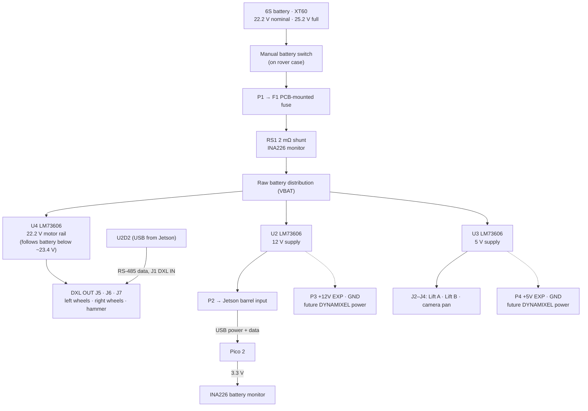

# Rover — Power Distribution Board (PDB) & Electronics Design Handover

| | |
|---|---|
| **Document** | PDB / Schematic & PCB Design Handover |
| **Project** | KSRC Lunar Rover (4-wheel mothership) |
| **Battery** | 6S1P LiPo, 2,800 mAh (22.2 V nominal, 25.2 V full), male XT60 |
| **Compute** | NVIDIA Jetson Orin Nano Super Dev Kit |
| **Real-time I/O MCU** | Raspberry Pi Pico 2 (RP2350, non-W) — socketed, powered by Jetson USB |
| **Mass constraint** | Total system ≤ 3 kg |
| **Power conversion** | 3× TI **LM73606** synchronous buck on the PDB (5 V, 12 V, 22.2 V motor rail) — one circuit block reused three times |
| **Design principle** | Keep the first board simple: one proven converter design repeated, clear connections, accessible measurements, minimum points of failure. |

> **Purpose:** Complete interface, power, and connector specification for laying out the PDB and wiring the rover electronics.
>
> **Before PCB ordering:** confirm the FS90MGR servo specifications, verify the motor-rail setpoint (§3.1), and finish the footprints, converter layout, and current-path calculations (§13).

---

## 1. System Overview

- **Jetson Orin Nano Super** — vision, teleoperation link, IMU sampling (SPI), high-level commands.
- **Pico 2 (RP2350)** — PWM for the 3 hobby servos and battery monitoring (INA226). USB from the Jetson carries both its **power and data**.
- **5× DYNAMIXEL XH430-V350-R** (4 wheels + 1 hammer) — RS-485, single bus driven by one **ROBOTIS U2D2**. The **PDB injects motor power into the bus itself** through on-board DYNAMIXEL ports (no U2D2 Power Hub), from a **22.2 V motor rail**.

The PDB converts battery power on-board with three LM73606 buck converters, distributes the outputs to the loads, holds the Pico 2, and reports battery use.

### 1.1 Design principles

| Principle | Design choice |
|---|---|
| One proven converter, repeated | Three identical LM73606 circuits supply 22.2 V (motors), 12 V, and 5 V. Only feedback resistors, output capacitors, and the BIAS connection differ. Laid out from the TI datasheet's layout example. |
| Keep protection straightforward | Keyed XT60, manual switch, and a PCB fuse beside the input. Check harness polarity; keep the unfused battery/switch leads short and secured. |
| Give the Pico one power source | Jetson USB provides power and data. Pico VSYS and VBUS have **no PDB connection**. |
| Use measurement for reporting | INA226 reports battery use. Follow the pack's discharge limits and switch off after use; there is no automatic cutoff. |
| Keep supply connections clear | Common GND; separate 24 V, 12 V, and 5 V positives. Jetson and Pico 3.3 V outputs also remain separate. |
| Prepare for later expansion | 12 V/GND and 5 V/GND solder pads from the existing converters, unwired in the first build. |

### 1.2 Power flow

All negative connections share GND.



The expansion pads are live whenever their converter is on. No cable or connector is fitted to them initially.

---

## 2. Component Interface List

| # | Component | Qty | Power | Current (idle / peak) | Protocol | Signal lines | Connects to |
|---|-----------|-----|-------|----------------------|----------|--------------|-------------|
| 1 | Jetson Orin Nano Super | 1 | 12 V (barrel 5.5×2.5, centre-positive) | 2.1 A / **3 A** incl. USB and M.2 devices | — | — | P2 via barrel cable |
| 2 | XH430-V350-R (wheels) | 4 | Motor rail 19.6–22.2 V | 36 mA / **0.7 A stall ea** | DYNAMIXEL 2.0 RS-485 | GND, VDD, D+, D− | PDB J5 (left pair), J6 (right pair) |
| 3 | XH430-V350-R (hammer) | 1 | Motor rail 19.6–22.2 V | 36 mA / **0.7 A stall** | DYNAMIXEL 2.0 RS-485 | GND, VDD, D+, D− | PDB J7 |
| 4 | FS90MGR (string lift) | 2 | 5 V | 10 mA / **0.8 A stall ea** (provisional) | PWM 50 Hz, 900–2100 µs, 3.3 V logic | PWM, 5 V, GND | J2, J3 (independent PWM each) |
| 5 | FS90MGR (camera pan) | 1 | 5 V | 10 mA / 0.8 A (provisional) | PWM, 3.3 V logic | PWM, 5 V, GND | J4 |
| 6 | Pico 2 (RP2350) | 1 | **Jetson USB** (VSYS/VBUS not connected to PDB) | ~100 mA | USB serial | USB | SKT1; micro-USB → Jetson |
| 7 | INA226 battery monitor | 1 | 3.3 V (Pico 3V3 OUT) | 0.4 mA | I²C (no SPI) | SDA, SCL (ALERT unused) | Pico I²C0 |
| 8 | BMI088 (Bosch Shuttle Board 3.0) | 1 | 3.3 V | 5 mA | SPI, 2× CS | SCK, MOSI, MISO, CSB1, CSB2, INT1, INT3 | Jetson SPI0 (§5) |
| 9 | ADXL375 (on hammer) | 1 | 3.3 V | 0.1 mA | SPI 4-wire | SCK, MOSI, MISO, CS, INT1 | Jetson SPI1 (§5) |
| 10 | NVMe SSD 256 GB | 1 | slot | 1–2 A peak | PCIe | M.2 M-key 2280 | Jetson |
| 11 | Intel AX210NGW | 1 | slot | 0.5 A | PCIe + USB | M.2 E-key, 2× MHF4 antennas | Jetson |
| 12 | Arducam B0201 (IMX291, 120°, UVC) | 1 | USB 5 V | 0.3–0.5 A | USB 2.0 | USB-A | Jetson |
| 13 | U2D2 | 1 | USB 5 V (logic) | 50 mA | USB ↔ RS-485 | micro-USB → Jetson; RS-485 4-pin → PDB J1 | Jetson + PDB |

---

## 3. Power Architecture

### 3.1 Converters — 3× TI LM73606 on the PDB

The [LM73606](https://www.ti.com/lit/ds/symlink/lm73606.pdf) is a 3.5–36 V input (42 V absolute maximum), 6 A synchronous buck converter with internal compensation, internal soft-start (6.3 ms), and cycle-by-cycle current limiting with hiccup short-circuit protection. The same circuit is used for all three rails.

| Ref | Rail | Setpoint | Planning load | Use |
|---|---|---:|---:|---|
| U4 | **Motor** | **22.2 V** (≈19.6 V at an empty pack) | 3.5 A / 78 W | DXL OUT J5–J7 → 5× XH430 |
| U2 | **12 V** | 12.07 V | 3 A / 36 W (Jetson incl. USB and M.2) + 12 V expansion | P2 → Jetson; P3 |
| U3 | **5 V** | 5.05 V | 2.4 A / 12 W (three servos, provisional) + 5 V expansion | J2–J4; P4 |

**Why the motor rail is capped, and why a buck is enough.** ROBOTIS lists the [XH430-V350](https://emanual.robotis.com/docs/en/dxl/x/xh430-v350/) at **24 V recommended with no published maximum**, while a full 6S pack is 25.2 V — so the rail is kept below 24 V. The motor runs from 11 V (default voltage limits 11.0–30.0 V), so it never needs boosting. U4 is set to **22.2 V**:
- Full pack (25.2 V): regulated to 22.2 V — worst-case tolerance gives ≤22.9 V, leaving ~1.1 V margin below 24 V for braking overshoot.
- If ROBOTIS confirms in writing that the XH430-V350 accepts 25.2 V, a later revision could feed the motors straight from the battery and remove U4.
- Below ~23.4 V (the LM73606 regulates up to 95% duty), U4 enters **dropout** via frequency foldback and the rail simply follows the battery minus a small drop (~0.2 V at 3.5 A). At an empty pack (19.8 V) the motors see about 19.6 V — slightly less top speed and torque than at 24 V.
- **Auto mode** (SYNC/MODE to GND) runs in diode emulation at light load: no negative inductor current, so motor braking energy is not pumped back into the battery rail.

### 3.2 Converter circuit (identical for U2, U3, U4)

| LM73606 pin | Connection |
|---|---|
| PVIN | VBAT (after C1). Input capacitors right at the pins: 2× 10 µF 50 V 1210 X7R + 100 nF |
| SW | 6.8 µH inductor (Bourns SRP1265A-6R8M) to VOUT; keep the SW copper area small |
| CBOOT | 470 nF 25 V from CBOOT to SW |
| VCC | 2.2 µF 16 V to GND; no external load |
| BIAS | **U2, U3: tie to VOUT** (TI recommendation for 3.3 V ≤ VOUT ≤ 18 V). **U4: tie to GND** (22.2 V exceeds the BIAS limit) |
| EN | **U2, U3:** 100 kΩ pull-up to PVIN (self-start when the battery is switched on). **U4:** controlled by the motor switch SW1 (§6.2) — off unless SW1 is ON |
| FB | RFBT (100 kΩ) from VOUT, RFBB to AGND — values below. VOUT = 1.006 V × (1 + RFBT / RFBB) |
| RT | **Open** → 500 kHz |
| SYNC/MODE | **GND** → auto mode (diode emulation at light load) |
| SS/TRK | Open → internal 6.3 ms soft-start |
| PGOOD | Not connected |
| AGND, PGND, exposed pad | Ground plane; exposed pad soldered with thermal vias |

| Rail | RFBB | Nominal VOUT | Worst case (FB ±1.1%, resistors ±1%) | Output capacitors | Inductor ripple at 25.2 V in |
|---|---:|---:|---|---|---:|
| U4 motor | **4.75 kΩ** | 22.18 V | 21.35–22.86 V | 4× 10 µF 50 V 1210 + **220 µF 50 V** electrolytic (braking energy) | 0.78 A (13%) |
| U2 12 V | **9.09 kΩ** | 12.07 V | ±2% | 4× 22 µF 25 V 1210 | 1.85 A (31%) |
| U3 5 V | **24.9 kΩ** | 5.05 V | ±2% | 6× 22 µF 25 V 1210 (+ C2 470 µF at the servo headers) | 1.19 A (20%) |

Inductor ripple sits within TI's recommended 10–30% of 6 A (12 V is at 27% at nominal battery voltage). Peak inductor current stays under 4 A on every rail, far below the inductor's 18 A saturation rating. U4's 22.2 V is below the 95%-of-VIN limit only while VIN ≥ 23.4 V; below that it operates in dropout as intended.

### 3.3 Power budget and fuse

The estimated output power for the **first build, with expansion pads unused, is about 126 W** (78 + 36 + 12). At an assumed 90% conversion efficiency (conservative for these synchronous converters), battery current is **6.3 A at 22.2 V**, or **7.1 A at 19.8 V**. These are planning values; 19.8 V is a calculation point, not a battery discharge limit.

Battery: 6S 2,800 mAh ≈ 62 Wh.

**10 A is the starting fuse choice.** Confirm startup behaviour, its time–current curve, wire protection, and available battery fault current before fixing that rating. A 10 A fuse does not open immediately at 10 A.

### 3.4 Battery input chain

1. **Battery** (male XT60) → **female XT60** → 12 AWG wire → **manual switch mounted on the rover case** (positive wire, reachable as an e-stop) → 12 AWG wire → **P1 solder pads**. The XT60 at the battery is the only connector in the high-current path.
2. The switch needs a suitable **DC make/break rating**. Keep the unfused battery/switch leads short and secured.
3. **F1:** PCB-mounted MINI blade fuse, directly after P1.
4. **RS1 + INA226:** 2 mΩ shunt after the fuse — measures total battery current and battery voltage.
5. **C1:** 220 µF 50 V bulk capacitor, after the shunt to GND.
6. **VBAT distribution** to the U2, U3 and U4 input capacitors. Each converter self-starts through its EN pull-up when the switch closes.

**Before first power-up:** check harness polarity with a multimeter, and bring the board up on a **current-limited bench supply** first (§10).

---

## 4. Pico 2 (RP2350) Pin Assignment

**Raspberry Pi Pico 2 (non-W)** in a socket (SKT1). Powered by **Jetson USB only**; VSYS and VBUS have no PDB connection. Retain it in the socket with a bracket or cable tie, and keep USB and BOOTSEL accessible.

| Pico physical pin | Function | Connect to |
|---:|---|---|
| 1 | GP0 | J2 — Lift A PWM |
| 2 | GP1 | J3 — Lift B PWM |
| 4 | GP2 | J4 — Camera pan PWM |
| 21 | GP16 / SDA | INA226 SDA |
| 22 | GP17 / SCL | INA226 SCL |
| 36 | 3V3(OUT) | INA226 supply and both I²C pull-ups |
| 3, 8, 13, 18, 23, 28, 33, 38 | Ground pins | PDB GND |
| 39, 40 | VSYS, VBUS | **No PDB connection** |

- Connect each PWM signal to GND through its own **10 kΩ** pull-down, so a missing or unpowered Pico holds the servo inputs low.
- Every servo has its **own PWM line**, so the two string servos can be trimmed independently.
- Leave all other Pico signals unused in the first build. Use the [Pico 2 pinout](https://datasheets.raspberrypi.com/pico/pico-2-datasheet.pdf) to orient the sockets.
- **Failsafe:** firmware sends calibrated neutral after 300 ms without a fresh valid command. This cannot act when USB power is lost — verify servo behaviour with USB unplugged (§10).

---

## 5. Jetson Orin Nano Connection Map

### 5.1 40-pin expansion header

Enable both SPI buses first: `sudo /opt/nvidia/jetson-io/jetson-io.py` → *Configure 40-pin expansion header* → enable both SPI controllers (pins 19/21/23/24/26 and 13/16/18/22/37), save, reboot.

| Header pin | Jetson signal | Dir | Device | Device pin |
|-----------|---------------|-----|--------|------------|
| 1 | 3.3 V | power | BMI088 | VDD + VDDIO |
| 17 | 3.3 V | power | ADXL375 | VS + VDDIO |
| 6, 9 | GND | — | BMI088 | GND |
| 20, 25 | GND | — | ADXL375 | GND |
| 19 | SPI0_MOSI | out | BMI088 | SDX |
| 21 | SPI0_MISO | in | BMI088 | SDO1 + SDO2 tied |
| 23 | SPI0_SCK | out | BMI088 | SCX |
| 24 | SPI0_CS0 | out | BMI088 | CSB1 (accelerometer) |
| 26 | SPI0_CS1 | out | BMI088 | CSB2 (gyroscope) |
| 29 | GPIO01 | in | BMI088 | INT1 (accel data-ready) |
| 31 | GPIO11 | in | BMI088 | INT3 (gyro data-ready) |
| 37 | SPI1_MOSI | out | ADXL375 | SDI |
| 22 | SPI1_MISO | in | ADXL375 | SDO |
| 13 | SPI1_SCK | out | ADXL375 | SCLK |
| 18 | SPI1_CS0 | out | ADXL375 | CS |
| 7 | GPIO09 | in | ADXL375 | INT1 (shock / FIFO) |

**Wiring notes:**
- Header side: crimped housings secured with hot glue — loose jumpers fail under vibration.
- **BMI088 PS pin:** strap for SPI per the BMI088 datasheet pin table (verify before soldering). In SPI mode SDO1 and SDO2 share MISO.
- BMI088 Shuttle Board 3.0 has **1.27 mm pitch** pins; mount it rigidly near the rover's centre on a thin damping pad.
- **ADXL375 on the moving hammer:** 26–28 AWG silicone (high-flex) wire, slack loop, both ends anchored, short run, SPI ≤1 MHz to start. Use its FIFO + shock interrupt.

### 5.2 Ports and slots

| Port / slot | Device | Notes |
|-------------|--------|-------|
| DC barrel jack 5.5×2.5 | 12 V from **P2** | The only power input ([hardware layout](https://docs.nvidia.com/jetson/orin-nano-devkit/user-guide/latest/hardware_layout.html)). Strain-relieve the plug |
| USB-A stack 1 | **U2D2**, **Pico 2** | micro-USB → USB-A **data** cables, right-angle at the micro-USB end; retain each plug |
| USB-A stack 2 | **Arducam B0201** | Camera alone on its stack |
| USB-C | Flashing / recovery | Data only |
| M.2 Key-M 2280 | **NVMe SSD 256 GB** | Boot drive — flash with SDK Manager from an Ubuntu x86 PC |
| M.2 Key-E | **Intel AX210NGW** | Replaces the stock Wi-Fi card; antennas above the chassis |
| Gigabit Ethernet | Bench debug tether | |

**udev rules:** pin the U2D2 and Pico serial ports to fixed names (e.g., `/dev/dxl`, `/dev/pico`) by USB serial number.

---

## 6. PDB Connections

Pin numbers are **PCB connector pins**, not a view into a loose cable plug. Mark voltage, polarity, and pin 1 on the board.

### 6.1 Power I/O

| Ref | Connection | Type | Wiring |
|-----|------------|------|--------|
| **P1** | Battery input | Plated through-hole solder pads + cable anchor | Pin 1: switched battery positive; pin 2: GND. Start with 12 AWG; check hole size against the actual stranded wire |
| **P2** | Jetson output | Plated through-hole solder pads + cable anchor | Pin 1: 12 V; pin 2: GND. Start with 18 AWG to a **5.5 × 2.5 mm, centre-positive barrel plug** |
| **P3** | 12 V expansion | Two plated solder pads, **unwired** | **+12V EXP** from U2's output, and **GND**. Shares the Jetson supply |
| **P4** | 5 V expansion | Two plated solder pads, **unwired** | **+5V EXP** from U3's output, and **GND**. Shares the hobby-servo supply |
All three converters are on the PDB; there are no external converter connections. Motor power leaves the board through the DYNAMIXEL ports (§6.2). Label any raw-battery test pad **VBAT** to distinguish it from regulated outputs.

### 6.2 DYNAMIXEL bus (replaces the U2D2 Power Hub)

The U2D2 Power Hub only joins a power input to the VDD pins of its JST ports. The PDB does the same job directly, with U4's output already fused and measured.

```text
Jetson ──USB──> U2D2 ──Robot Cable-X4P──> J1 DXL IN   (GND, D+, D− only — VDD not connected)
                                             │  D+/D− bused to all three outputs
                                             │  VDD = U4 motor rail (22.2 V)
                      ┌──────────────────────┼──────────────────────┐
                J5 DXL OUT A           J6 DXL OUT B           J7 DXL OUT C
                FL wheel → RL wheel    FR wheel → RR wheel    Hammer
                (ID 1, ID 2)           (ID 3, ID 4)           (ID 5)
```

| Ref | Purpose | Connector | Pinout (ROBOTIS RS-485, JST EH) |
|-----|---------|-----------|---------------------------------|
| **J1** | DXL IN from U2D2 | JST **B4B-EH-A** | 1 = GND, 2 = VDD **not connected**, 3 = D+, 4 = D− |
| **J5** | DXL OUT A — left wheels | JST **B4B-EH-A** | 1 = GND, 2 = VDD (motor rail), 3 = D+, 4 = D− |
| **J6** | DXL OUT B — right wheels | JST **B4B-EH-A** | same as J5 |
| **J7** | DXL OUT C — hammer | JST **B4B-EH-A** | same as J5 |

**Design points:**
- **VDD on J1 is left unconnected.** The U2D2 supplies no motor power and ties the VDD pins of its own ports together; connecting J1's VDD would put 22.2 V on the U2D2's TTL port, where a TTL servo plugged in by mistake would be destroyed.
- **Three short chains instead of one long chain.** Each XH430 has two connectors wired in parallel, so each chain is PDB → motor → motor. A JST EH contact is rated **3 A**; all five motors stalling together draw 3.5 A, so one chain would overload the first connector. Split three ways, the worst port carries 1.4 A.
- **Topology:** three branches from the PDB form a short star, the same arrangement as the Power Hub's three ports. At these lengths (well under 1 m per branch) this works reliably at 1 Mbps and above. Route D+/D− on the PDB as a close, equal-length pair, away from the converter switch nodes.
- **Cables:** standard ROBOTIS Robot Cable-X4P, lengths measured on the chassis (PDB → first wheel, wheel → wheel). JST EH has only a friction lock: add a cable tie at each PDB header and at each motor.
- **U2D2 mounting:** it previously clipped onto the Power Hub; now fix it to the chassis next to the PDB (screws or a cable tie through its case) with a short Robot Cable-X4P to J1.
- **Motor IDs and baud rate:** new XH430s all ship as **ID 1 at 57,600 bps**. Connect them **one at a time** to set IDs (wheels 1–4, hammer 5) and a common baud rate (**1 Mbps** recommended) before chaining. Two motors with the same ID on the bus corrupt each other's replies.
- **One shared bus:** all five motors sit on the same D+/D− pair (RS-485 multidrop); only the addressed ID replies, and one Sync Read / Sync Write covers all five. Leave the **U2D2's TTL port empty** — it shares the same channel.
- **Termination:** ROBOTIS buses run unterminated at these lengths. Add 120 Ω only if communication errors appear.
- **Stall and fault protection:** a shorted motor cable trips U4's current limit (hiccup mode), taking down only the motor rail; the Jetson and servos keep running.
- **Bus Watchdog:** enable the XH430 Bus Watchdog (Protocol 2.0) so each motor stops if the Jetson stops sending commands.

### 6.3 Motor power switch (like the U2D2 Power Hub's)

SW1 turns the **motor rail only** on and off, so the Jetson, Pico, and servos keep running — for bench work, handling the rover, and as a motor-only stop. It does not switch motor current: it drives U4's **EN pin**, so it carries under 0.5 mA at 5 V.

```text
+5V (U3 out) ── SW1 (ON) ── JP1 ── R19 10 kΩ ──┬── U4 EN
                            │                    └── R15 100 kΩ ── GND
                     J8 (footprint) across JP1
Motor rail ── R20 10 kΩ ── D2 green LED ── GND      ("MOTORS LIVE")
```

- **Fail-safe:** EN is pulled to GND by R15. The motor rail runs only while SW1 is ON; a broken switch or wire turns the motors **off**, never on. SW1 ON gives EN ≈ 4.6 V (threshold 1.2 V).
- **Why from 5 V:** the switch then only ever sees 5 V (SW1 is rated 12 V), and U4 cannot start before the 5 V rail is up.
- **D2** lights whenever the motor rail is live (~2 mA).
- **Case-mounted stop (optional, no parts):** J8 is a 2-pin footprint across solder jumper JP1 (bridged by default). To add a switch on the rover case, cut JP1 and wire the case switch to J8 — the motors then need **both** SW1 and the case switch ON.
- **When the motors are switched off they lose holding torque:** wheels freewheel and the **hammer can drop** under gravity. Lower the hammer to its rest position before switching off. The Jetson sees the motors stop responding until SW1 is switched back on (re-enable torque in software afterwards).

### 6.4 Signal connectors

| Ref | Purpose | Connector | Pinout |
|-----|---------|-----------|--------|
| J2 | Lift A | 3-pin 2.54 mm header | 1 = PWM (GP0), 2 = servo 5 V, 3 = GND |
| J3 | Lift B | 3-pin 2.54 mm header | 1 = PWM (GP1), 2 = servo 5 V, 3 = GND |
| J4 | Camera pan | 3-pin 2.54 mm header | 1 = PWM (GP2), 2 = servo 5 V, 3 = GND |
| SKT1 | Pico 2 socket | 2× 1×20 2.54 mm female header | per §4 |

Confirm the servo pinout against the purchased plug before layout. These connectors do not latch: verify plug orientation and retain the plugs and the Pico mechanically.

### 6.5 Test pads

Labeled test pads for: **battery after shunt, motor supply, 12 V, 5 V, 3.3 V, GND**.

---

## 7. INA226 Battery Monitor

The [INA226](https://www.ti.com/lit/ds/symlink/ina226.pdf) uses **I²C/SMBus and has no SPI interface**. Its ALERT output is unused.

```text
F1 fuse ─────┬──── RS1 2 mΩ shunt ────┬──── three converter inputs
             │                        │
          INA IN+                  INA IN−
                                      └──── INA VBUS
```

| INA226 pin | Name | Connect to |
|---:|---|---|
| 1, 2 | A1, A0 | GND; selects address 0x40 |
| 3 | ALERT | Unconnected |
| 4 | SDA | Pico GP16; 4.7 kΩ pull-up to Pico 3.3 V |
| 5 | SCL | Pico GP17; 4.7 kΩ pull-up to Pico 3.3 V |
| 6 | VS | Pico 3.3 V; 100 nF to GND beside the IC |
| 7 | GND | Common GND |
| 8 | VBUS | Battery distribution after the shunt |
| 9 | IN− | Shunt terminal facing the converters |
| 10 | IN+ | Shunt terminal facing the fuse |

**Firmware scaling** for the 2 mΩ shunt: **current LSB = 1 mA/count**, **calibration register = 0x0A00**, **power LSB = 25 mW/count**. Program calibration after every reset and compare readings with an independent meter. A failed read must show "measurement unavailable."

---

## 8. Layout Rules

1. **Continuous ground plane** and short, wide power paths.
2. Keep monitor sense traces and all FB traces away from converter switching nodes.
3. **Converter layout (U2–U4) — the most layout-sensitive part of the board.** Copy the LM73606 datasheet's layout example for each converter:
   - Input capacitors (10 µF + 100 nF) directly at PVIN/PGND — the hot loop must be as small as possible.
   - Keep the SW node copper small; place the inductor right next to SW.
   - Route FB from the output capacitor side of VOUT; keep RFBT/RFBB next to the FB pin.
   - Solder the exposed pad to a ground pour with an array of thermal vias to the bottom layer (main heat path).
   - Keep the three converters physically separate, with their own local input/output capacitors.
   - The WQFN-30 package must be **factory-assembled** (JLCPCB) — its exposed pad cannot be reliably hand-soldered.
4. **Shunt:** use the [Bourns sensing-pad layout](https://www.bourns.com/docs/product-datasheets/css2h-2512.pdf). It is a two-terminal resistor: separate sense traces must meet the terminals directly. At 7.4 A it drops about 15 mV and dissipates 0.11 W.
5. **Copper:** two layers, 2 oz copper as a starting proposal. Calculate capacity through **pads, traces, and vias**, then verify heating (three converters dissipate roughly 1–2 W each at full load).
6. **Bulk capacitors:** C1 after the shunt to GND; C2 near the servo headers from 5 V to GND; C5 at U4's output. All polarized. The selected **B-suffix parts use 5 mm formed lead spacing** — do not substitute the bare-lead footprint. Follow each converter's capacitor requirements.
7. **Fuse holder:** use the exact [Littelfuse drawing](https://datasheet.lcsc.com/datasheet/pdf/5dd658d7c0c120ed4252709c4e00b44b.pdf?productCode=C206907), including its locking feature and replacement clearance. Check current derating.
8. **Expansion pads:** near the board edge with cable anchors. Branch from each converter's output and ground area so expansion current does not pass through the Jetson cable or servo headers. Include expansion current in shared paths.
9. **Pico sockets:** per the [LXWCONN drawing](https://datasheet.lcsc.com/datasheet/pdf/f0f6c3d8697d24302649e706e8fbe0d7.pdf?productCode=C53202183) — 8.5 mm body height, 3.2 mm tails, 1.02 mm recommended holes. Fit after SMT reflow, following its soldering limits.
10. **DYNAMIXEL ports (J1, J5–J7):** place at the board edge facing the motor cable routes, with a cable-tie slot beside each. Size the VDD/GND copper from U4 to J5–J7 for the full 6 A converter rating; route D+/D− as a close, equal-length pair from J1 to the three outputs, clear of all SW nodes.
11. Secure cables to mounting points so vibration does not load solder joints.
12. Silkscreen voltage, polarity, and pin 1 at every connection.

---

## 9. Bill of Materials

### 9.1 On the PDB — assigned LCSC parts

Quantities are **per board**, not order minimums. The expansion solder pads are PCB features and add no parts.

**Converters (U2, U3, U4 — identical circuit ×3):**

| Ref | Function | Qty | Manufacturer part number | LCSC / stock shown | Reason / important rating |
|---|---|---:|---|---|---|
| U2, U3, U4 | Buck converter | 3 | TI **LM73606RNPR** | [C544826](https://www.lcsc.com/product-detail/C544826.html) · 2,544 | 3.5–36 V in (42 V abs. max), 6 A, synchronous, internally compensated; WQFN-30 (4×6 mm) |
| L1–L3 | Power inductor | 3 | Bourns **SRP1265A-6R8M** | [C2041326](https://www.lcsc.com/product-detail/C2041326.html) · 432 | 6.8 µH, 18 A saturation, 11.5 A rated, 9.5 mΩ; 13.5×12.5 mm |
| C10–C19 | Input caps (2 per converter) + U4 output caps (4) | 10 | Murata **GRM32ER71H106KA12L** | [C77102](https://www.lcsc.com/product-detail/C77102.html) · 43,025 | 10 µF, 50 V, X7R, 1210 |
| C20–C29 | U2 output (4) + U3 output (6) | 10 | Samsung **CL32B226KAJNNNE** | [C309062](https://www.lcsc.com/product-detail/C309062.html) · 105,892 | 22 µF, 25 V, X7R, 1210 |
| C30–C32 | Input high-frequency bypass | 3 | Samsung **CL21B104KBCNNNC** | [C1711](https://www.lcsc.com/product-detail/C1711.html) | 100 nF, 50 V, X7R, 0805 (same part as C3) |
| C33–C35 | CBOOT | 3 | Samsung **CL10B474KA8NNNC** | [C1623](https://www.lcsc.com/product-detail/C1623.html) · 403,420 | 470 nF, 25 V, X7R, 0603 |
| C36–C38 | CVCC | 3 | Samsung **CL10A225KO8NNNC** | [C23630](https://www.lcsc.com/product-detail/C23630.html) · 1,049,350 | 2.2 µF, 16 V, X5R, 0603 |
| C5 | U4 motor-rail bulk | 1 | Panasonic **EEU-FR1H221B** | [C1579630](https://www.lcsc.com/product-detail/C1579630.html) | 220 µF, 50 V (same part as C1) — absorbs motor braking energy |
| R10–R15 | RFBT (×3), U2/U3 EN pull-ups (×2), U4 EN pull-down (R15) | 6 | Yageo **RC0805FR-07100KL** | [C96346](https://www.lcsc.com/product-detail/C96346.html) · 767,900 | 100 kΩ, ±1%, 0805 |
| R19, R20 | U4 EN series (R19), motor LED (R20) | 2 | Yageo **RC0805FR-0710KL** | [C84376](https://www.lcsc.com/product-detail/C84376.html) | 10 kΩ, ±1%, 0805 (same part as R3–R5) |
| SW1 | Motor power switch | 1 | C&K **OS102011MA1QN1** | [C226259](https://www.lcsc.com/product-detail/C226259.html) · 25 | SPDT slide, through-hole, 100 mA @ 12 V (signal only — sees 5 V) |
| D2 | "Motors live" indicator | 1 | Kento **KT-0805G** | [C2297](https://www.lcsc.com/product-detail/C2297.html) · 509,750 | Green LED, 0805 |
| R16 | RFBB, U3 (5 V) | 1 | Yageo **RC0805FR-0724K9L** | [C155691](https://www.lcsc.com/product-detail/C155691.html) · 2,000 | 24.9 kΩ, ±1%, 0805 |
| R17 | RFBB, U2 (12 V) | 1 | Yageo **RC0805FR-079K09L** | [C273842](https://www.lcsc.com/product-detail/C273842.html) · 500 | 9.09 kΩ, ±1%, 0805 |
| R18 | RFBB, U4 (motor 22.2 V) | 1 | Yageo **RC0805FR-074K75L** | [C137517](https://www.lcsc.com/product-detail/C137517.html) · 45,200 | 4.75 kΩ, ±1%, 0805 |

**Protection, sensing, and connectors:**

| Ref | Function | Qty | Manufacturer part number | LCSC / stock shown | Reason / important rating |
|---|---|---:|---|---|---|
| U1 | Battery monitor | 1 | TI **INA226AIDGSR** | [C49851](https://www.lcsc.com/product-detail/C49851.html) · 44,936 | 36 V bus operating range; 10-pin VSSOP; I²C |
| RS1 | Current shunt | 1 | Bourns **CSS2H-2512K-2L00F** | [C2093761](https://www.lcsc.com/product-detail/C2093761.html) · 2,847 | 2 mΩ, ±1%, 5 W at 70 °C terminal temperature; AEC-Q200 |
| F1 | PCB fuse holder | 1 | Littelfuse **01530008Z** | [C206907](https://www.lcsc.com/product-detail/C206907.html) · 316 | MINI blade type; 32 V DC; mechanical board-lock anchor |
| F1 | Main fuse, provisional rating | 1 | Littelfuse **0297010.WXNV** | [C151094](https://www.lcsc.com/product-detail/C151094.html) · 10,285 | 10 A, 32 V DC; 1,000 A interrupting rating at 32 V DC |
| C1 | Battery bulk capacitor | 1 | Panasonic **EEU-FR1H221B** | [C1579630](https://www.lcsc.com/product-detail/C1579630.html) · 985 | 220 µF, 50 V; FR series; 8,000 h endurance at 105 °C |
| C2 | Servo bulk capacitor | 1 | Panasonic **EEU-FR1C471B** | [C1579437](https://www.lcsc.com/product-detail/C1579437.html) · 99 | 470 µF, 16 V; FR series; 6,000 h endurance at 105 °C |
| C3 | Monitor supply bypass | 1 | Samsung **CL21B104KBCNNNC** | [C1711](https://www.lcsc.com/product-detail/C1711.html) · 991,580 | 100 nF, 50 V, X7R, 0805 |
| R1, R2 | I²C pull-up resistors | 2 | Yageo **RC0805FR-074K7L** | [C60816](https://www.lcsc.com/product-detail/C60816.html) · 4,177,000 | 4.7 kΩ, ±1%, 0805; one per I²C line |
| R3–R5 | Servo signal pull-downs | 3 | Yageo **RC0805FR-0710KL** | [C84376](https://www.lcsc.com/product-detail/C84376.html) · 1,712,800 | 10 kΩ, ±1%, 0805; one per PWM signal |
| J1, J5–J7 | DYNAMIXEL ports (1 in, 3 out) | 4 | JST **B4B-EH-A(LF)(SN)** | [C160258](https://www.lcsc.com/product-detail/C160258.html) · 69,950 | 4-pin, 2.5 mm pitch, through-hole; 3 A per contact; mates with Robot Cable-X4P |
| J2–J4 | Servo headers | 3 | Samtec **TSW-103-07-G-S** | [C3335811](https://www.lcsc.com/product-detail/C3335811.html) · 2,670 | Three pins, 2.54 mm pitch; through-hole, gold mating contacts |
| SKT1 | Pico sockets | 2 | LXWCONN **254PM-1x20P-V** | [C53202183](https://www.lcsc.com/product-detail/C53202183.html) · 1,340 | 1×20, 2.54 mm; through-hole; gold-flash contacts; 3 A rating |
| MCU | Pico module | 1 | Raspberry Pi **Pico 2**, non-W | [C41407547](https://www.lcsc.com/product-detail/C41407547.html) · 144 | Check whether the supplied module has headers |
| — | Male headers for a bare Pico | 2 if needed | Samtec **TSW-120-07-G-S** | [C3335373](https://www.lcsc.com/product-detail/C3335373.html) · 9 | 1×20, 2.54 mm; mate with the selected sockets |

**All assigned parts showed stock on 29 September 2026.** Counts are a snapshot of LCSC's product pages, not reserved inventory. Low-stock lines to watch: **SW1 (25 — buy a spare; any SPDT slide switch rated ≥5 V works)**, **SRP1265A-6R8M (432)**, **9.09 kΩ (500)**, and the Pico male headers (**9 pieces**; two needed for a bare Pico). The Samsung CL32B106KBJNNNE 10 µF 50 V showed **zero stock**, which is why the Murata part is used. Recheck stock and order minimums before purchase; LCSC stock does not establish assembly-service availability.

### 9.2 Off-board items

| Item | Status |
|------|--------|
| 6S 2,800 mAh 50C LiPo (male XT60) | Bought |
| Manual switch with suitable DC make/break rating | **To choose** |
| Female XT60 + 12 AWG wire (battery ↔ switch ↔ P1) | Needed |
| 18 AWG wire + 5.5×2.5 mm centre-positive barrel plug (P2 → Jetson) | Bought (DC 2-wire → plug cable) |
| Cable ties, mounting hardware (PDB, U2D2) | Needed |
| U2D2 + Robot Cable-X4P (1 short for U2D2 → J1, plus measured lengths for 3 chains) | Confirm owned — **Power Hub no longer needed** (keep as a bench spare) |
| 5× XH430-V350-R, 3× FS90MGR | Owned |
| BMI088 Shuttle Board 3.0 + 1.27 mm header | Bought |
| ADXL375 + 26–28 AWG silicone wire | Confirm ordered |
| INA226 modules (R010) | Bought (bench prototyping) |
| Arducam B0201 | Owned |
| AX210NGW + antennas, NVMe SSD 256 GB | Bought |
| USB-A → micro-USB data cables (U2D2, Pico) | Bought — right-angle micro-USB end preferred |
| Station: ipTIME AX3000Q, ipTIME U1G-C, CAT6 | Bought |

---

## 10. Bring-up Plan

| Order | Check | Accept when |
|---:|---|---|
| 1 | Unpowered inspection: footprints, pin 1, capacitor polarity, harness polarity, rail-to-GND shorts; run schematic and PCB rule checks | Physical parts and pin assignments match; no unintended short |
| 2 | Current-limited bench supply (start ~15 V, 0.3 A limit), loads and Pico removed; raise to 25.2 V; measure each converter output and both expansion pad pairs | U4 ≈ 22.2 V, U2 ≈ 12.07 V, U3 ≈ 5.05 V; no unexplained current or heating |
| 2a | Toggle SW1 | Motor rail and D2 follow SW1; U2/U3 unaffected; with SW1 OFF, U4 EN reads ~0 V |
| 2b | SW1 ON; lower the bench supply from 25.2 V to 19.8 V while watching U4 | U4 holds 22.2 V down to ~23.4 V in, then follows the input smoothly (dropout); U2 and U3 stay in regulation throughout |
| 3 | Pico on USB, then a known battery-side load | Communication and monitor readings agree with a meter; USB does not energize the servo rail |
| 4 | Jetson with its peripherals; then one servo and all three | No resets; supply voltage at each load remains within its specification |
| 5 | Motors: start slowly, then test acceleration, reversal, braking, and representative load | Oscilloscope shows the motor rail stays within its allowed band; input overshoot stays within component limits |
| 6 | Complete assembly at the lowest approved input, with its intended enclosure | Temperatures settle within ratings; no connector heating; command-loss and power-loss behaviour are acceptable |
| Later | Before using expansion: update the load budget and cable/fault protection; test motor startup, stall demand, and braking with existing loads connected | Combined current and temperature stay within ratings; no harmful rail spikes, Jetson resets, or servo disturbance |

**Critical tests:** the INA226 bus operating limit is 36 V; the LM73606 accepts up to 36 V (42 V absolute maximum). The motor rail must stay **below 24 V** during braking. Check input spikes as well as the motor output — a multimeter can miss brief spikes and dips. Connect the battery only after the controlled-supply checks pass.

**Servo behaviour:** test the FS90MGRs unloaded with the mechanism supported. Verify behaviour with USB unplugged (Pico unpowered, PWM held low by the pull-downs). Separately test stale motor commands while telemetry continues; the DYNAMIXEL Bus Watchdog alone watches bus traffic.

---

## 11. Failure Points Worth Checking

| Symptom | Measure first | Improvement if confirmed |
|---|---|---|
| Whole board loses power | Voltage before/after fuse and shunt | Repair the open joint or failed part; find the fault before replacing a fuse |
| One rail is dead or at the wrong voltage | EN pin voltage, FB resistor values, VCC (~5 V), exposed-pad solder (X-ray/AOI from the assembler) | Correct the resistor or joint; a converter in hiccup mode points to a short or overload on its output |
| Converter runs hot or audibly whines | Output ripple and SW node on an oscilloscope; inductor temperature | Check layout against the datasheet example, input capacitor placement, and load |
| Motors reset or motor voltage rises during braking | Motor output and voltage at the farthest motor | Correct converter capacity, wiring loss, or braking-energy handling |
| Jetson resets / servos jitter, especially when an expansion motor moves | Voltage at the barrel plug / servo plug during startup and braking | Correct shared-supply capacity, voltage spikes, or wiring loss; use a separate motor supply if sharing cannot meet the limits |
| Battery reading is wrong | Known current, calibration, shunt sense connections | Correct calibration or sensing layout |
| Motion continues after command or USB loss | Command age and actual actuator response | Correct timeout handling or change the affected actuator's power/control arrangement |
| Fault appears during vibration | Socket, USB plug, terminal, and cable retention | Secure or replace the loose connection |

---

## 12. Future Extensions

| Extension | How to add it |
|-----------|---------------|
| **12 V / 5 V DYNAMIXELs** | Power from **P3 (+12V EXP)** or **P4 (+5V EXP)**. Control through the U2D2's [TTL or RS-485 interface](https://emanual.robotis.com/docs/en/parts/interface/u2d2/) with common GND. The pads provide power only |
| **More XH430-V DYNAMIXELs** | Extend a chain from J5–J7, keeping each port under 3 A and the total within U4's 6 A rating (5 motors use ~3.5 A stall). Unique IDs |
| **Intel RealSense / USB depth camera** | Jetson USB 3 (stack 2) — no PDB power needed |
| **Autonomy camera (CSI)** | Jetson's 2× MIPI CSI ports — no PDB impact |

**Rules for expansion power:**
- **Current is shared.** Jetson current plus 12 V expansion current must fit the tested 12 V supply capacity; hobby-servo current plus 5 V expansion current must fit the tested 5 V capacity. No spare current is reserved in the present budget.
- **Match the motor voltage.** Check the exact model's allowed range against regulator tolerance and transients. Keep the 5 V, 12 V, and 22.2 V motor power wiring separate; never join their positive rails.
- **Never plug a TTL servo or a 12 V DYNAMIXEL into J5–J7** — they carry the 22.2 V motor rail.
- U2 and U3 are each rated 6 A. The 12 V rail has ~2.5 A left after the Jetson; the 5 V rail has ~3 A left after the servos (before thermal checks).
- Run the "Later" bring-up check (§10) before relying on any expansion.

---

## 13. Open Items

- [ ] **Motor rail (U4):** confirm 22.2 V (19.6 V at an empty pack) gives acceptable wheel speed and hammer torque, and that braking overshoot stays below 24 V at J5–J7 (bring-up step 5).
- [ ] **Motor chains:** measure Robot Cable-X4P lengths on the chassis; set IDs 1–5 and 1 Mbps one motor at a time before chaining.
- [ ] **Converter layout:** follow the LM73606 datasheet layout example for all three converters; order with JLCPCB assembly (WQFN-30). Optional: have a second engineer review the three converter layouts before ordering.
- [ ] **Hardware low-battery cutoff (optional, 3 resistors):** replace the U2 and U3 100 kΩ EN pull-ups with dividers so they switch off below ~19 V (EN threshold 1.196 V); U4 follows automatically, since its enable comes from the 5 V rail through SW1. Adds battery protection with no firmware.
- [ ] **Switch selection and fuse coordination:** DC make/break rating; confirm the 10 A fuse against startup, time–current curve, wire protection, and battery fault current.
- [ ] **FS90MGR verification:** identity, current, and missing-signal response. The team reports 3.3 V PWM working; confirm with the purchased units.
- [ ] **String-lift torque:** confirm 2× FS90MGR is enough — torque = load × spool radius.
- [ ] **Pan:** camera is for operator awareness only. Trim the stop pulse, enforce a coarse **±270°** software limit, add a **"set centre"** button for operator re-zero, leave about one turn of cable slack.
- [ ] **ADXL375 range:** estimate peak g from hammer mass and drop height; ±200 g must not saturate.
- [ ] **BMI088 PS strap:** confirm the SPI setting in the datasheet.
- [ ] **udev rules** for U2D2 and Pico.
- [ ] **RS-485 bus:** add 120 Ω termination at the far end only if long cables show errors.
- [ ] **Final footprints, wiring, and thermal results.**

---

## 14. Net Legend

| Signal type | Nets |
|-------------|------|
| VBAT | P1 → F1 → RS1 → C1 → U2, U3, U4 inputs |
| Motor rail 22.2 V | U4 → C5 → J5, J6, J7 (VDD) → 5× XH430; D2 indicator |
| Motor enable | +5V → SW1 → JP1 (J8) → R19 → U4 EN; R15 pull-down |
| 12 V | U2 → P2 → Jetson; P3 (+12V EXP, unwired) |
| 5 V | U3 → C2, J2–J4 servo power; P4 (+5V EXP, unwired) |
| 3.3 V | Pico 3V3(OUT) → INA226, I²C pull-ups |
| RS-485 | U2D2 → J1 (D+, D−, GND) → bused on PDB → J5, J6, J7 → 5× XH430 |
| PWM | GP0–GP2 → J2–J4 (10 kΩ pull-downs) |
| I²C | Pico I²C0 → INA226 (0x40) |
| SPI | Jetson SPI0 → BMI088, SPI1 → ADXL375 (off-board) |
| USB | U2D2, Pico (power + data), camera → Jetson |

---

### Component source notes

Ratings come from manufacturer documents; LCSC links identify purchase codes. Supporting references: [Panasonic FR catalog](https://datasheet.lcsc.com/datasheet/pdf/d9089262f7a6df5ba99d8a966a03ede0.pdf?productCode=C178407), [Littelfuse MINI fuse data sheet](https://datasheet.lcsc.com/datasheet/pdf/6640fa58723348e000da25e795536560.pdf?productCode=C151094), [Samtec servo header](https://www.samtec.com/products/tsw-103-07-g-s), [LM73606 datasheet](https://www.ti.com/lit/ds/symlink/lm73606.pdf), [U2D2 Power Hub pinout](https://emanual.robotis.com/docs/en/parts/interface/u2d2_power_hub/). Planning loads and proposed wiring are project choices; they still require the bring-up checks above.
