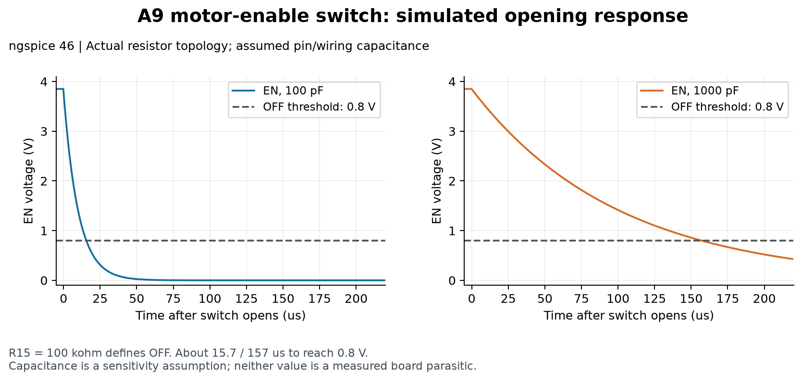
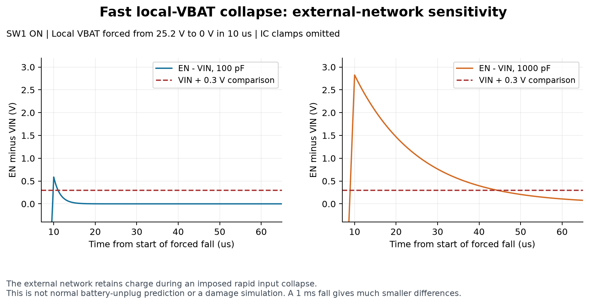
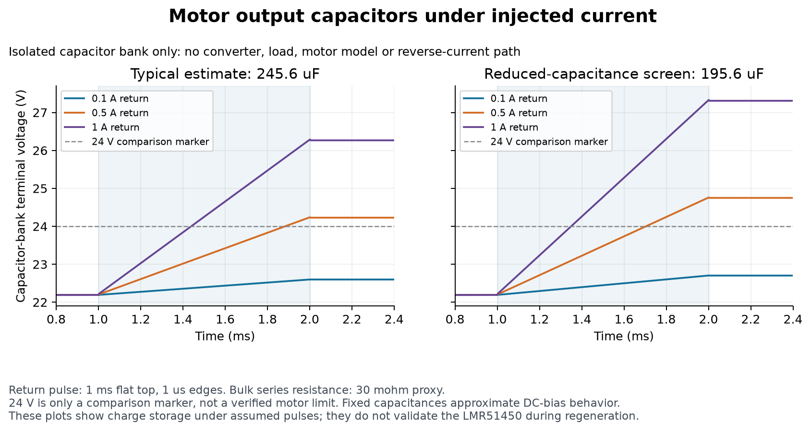

# Rover PDB A9 simulation results

**Partial verification completed: 60 passive-network ngspice simulations ran.
The three LMR51450 converters have not yet been simulated.** PSpice for TI is
not installed on this host. Its download requires the owner's TI account login.
The encrypted TI model cannot be run by the installed ngspice engine.

These are retained results for the hash-bound A9 snapshot listed in
`cad-binding.json`, not a fresh check of later owner CAD. The runner intentionally
refuses changed schematic hashes, including later footprint-field changes;
reconcile those differences before rerunning. Raw decks, logs and waveforms are
kept because they substantiate the reported measurements.

The circuit remains A9. All seven native schematic files have the same SHA-256
hashes before and after these runs. No PCB was created and no schematic values
were changed. This work does not approve fabrication.

## What actually ran

The engine was **ngspice 46**, supplied with the existing KiCad 10 installation.
`results/results.json` records its DLL hash, version, CAD hashes, assumptions and
individual measurements. `results/raw-cases.zip` preserves all 180 original files:
one input `.cir`, complete `.log` and waveform `.csv` for each of the 60 cases.
Its manifest binds each member's SHA-256 and the exact `results.json` bytes. The
cleanup verified every archived member against its loose original before removing
the duplicates. No case was rerun or discarded during that repackaging.

| Test | Cases | Scope |
| --- | ---: | --- |
| Motor-enable DC sweep | 48 | Eight independent 1% resistor corners, switch ON/OFF, three leakage assumptions; local VBAT swept 19.8–25.2 V |
| Motor-enable switch transient | 2 | Switch opening/closing with assumed 100 pF or 1 nF EN-node capacitance |
| Forced local-VBAT fall | 4 | 10 us or 1 ms fall, each with 100 pF or 1 nF; external network only |
| Motor capacitor charge injection | 6 | Three return-current pulses and two capacitance estimates; isolated capacitor bank only |

All runs completed and produced finite waveforms through the requested analysis
interval. Independent arithmetic checked the resistor solutions, RC behavior and
charge conservation. **Completion is not a statement that all scenarios pass
electrical limits.** In particular, the imposed fast input collapse exposes a
conditional EN–VIN excursion, discussed below.

## Motor enable: ON and OFF are defined

The simulated topology is the native A9 circuit: VBAT → R19 100k → SW_SUPPLY,
R24 22k from SW_SUPPLY to AGND, SW1 from SW_SUPPLY to MOTOR_EN, and R15 100k
from MOTOR_EN to AGND. AGND and GND are ideal common returns in this model.

Across the tested battery range, resistor corners and signed leakage cases:

| Quantity | Simulated range | Interpretation |
| --- | ---: | --- |
| EN with SW1 ON | 2.973–3.917 V | Above TI's 1.4 V upper enable-threshold limit |
| EN with SW1 OFF | approximately −10.1 to +10.1 mV | Below TI's 0.8 V lower threshold limit; R15 prevents floating |

Leakage was swept through −0.1, 0 and +0.1 uA as a sensitivity test. TI lists a
typical 0.1 uA figure, **not a guaranteed maximum**. The signed sweep must not be
described as covering all IC leakage corners. SW1 is an ideal switch with 0.01 ohm
ON resistance and 1 teraohm OFF resistance; contact bounce is not modeled.

After SW1 opens, the simulated EN voltage crosses below 0.8 V in approximately
15.7 us with 100 pF, or 157 us with 1 nF. These capacitances are assumptions about
pin and wiring parasitics, not measurements or added schematic parts.



## Fast battery-rail collapse is a separate test

With SW1 ON, an ideal source forces **local VBAT** from 25.2 V to zero. The actual
battery, fuse, shared bulk capacitor, wiring and IC pin clamps are omitted from
this imposed-waveform experiment.

| Imposed fall time | Assumed EN capacitance | Maximum EN minus VIN |
| --- | ---: | ---: |
| 10 us | 100 pF | 0.587 V |
| 10 us | 1 nF | 2.825 V |
| 1 ms | 100 pF | 0.00588 V |
| 1 ms | 1 nF | 0.05882 V |

The rapid cases show that the external resistor network alone does not guarantee
EN tracks every arbitrarily fast VIN collapse. TI's recommended EN limit is VIN;
its absolute maximum is VIN + 0.3 V. The slower cases also briefly exceed the
recommended relationship, although they remain below the absolute-maximum offset.
Therefore this table is not a blanket sequencing pass.

These results **do not predict normal battery unplugging, actual clamped pin
voltage or IC damage**. Actual rail decay, parasitic capacitance and clamp behavior
must be established before deciding whether a circuit change is warranted. No
change has been made on the strength of an assumed extreme waveform.



## Capacitors alone do not clamp returned motor energy

The experiment starts an isolated C16–C19/C5 bank at 22.190374 V and injects
current for 1 ms, with 1 us rising/falling edges. It includes no motor, load, LED,
LMR51450 or reverse-current path. It tests charge storage, not actual motor braking.

- Typical estimate: 25.6 uF ceramic bank plus 220 uF bulk = 245.6 uF.
- Reduced-capacitance screen: 19.584 uF ceramic plus 176 uF bulk = 195.584 uF.
- C5 series resistance: 30 milliohms, using Panasonic's 100 kHz impedance as a
  first-pass constant-resistance proxy, not an exact ESR model.
- Ceramic capacitance is held fixed at an estimate near the initial voltage.
  Further DC-bias variation, ESL and temperature-dependent impedance are omitted.

| Assumed returned current | Typical-bank peak | Reduced-bank peak |
| --- | ---: | ---: |
| 0.1 A | 22.600 V | 22.704 V |
| 0.5 A | 24.239 V | 24.760 V |
| 1.0 A | 26.288 V | 27.330 V |

The settled results agree with `delta V = injected charge / total capacitance`.
The small difference between peak and settled voltage comes from the series
resistance. The 24 V plot line is a comparison marker, **not an established motor
maximum**. The reduced bank is a sensitivity screen, not a guaranteed worst case.
At elevated output voltage the real circuit may transfer energy through paths
that this isolated-bank test omits; none of these numbers is a prediction of the
assembled motor rail. The finding is that capacitor storage alone cannot establish
safe regenerative behavior.



## Converter tests waiting for PSpice

The official TI package **SNVMCB2**, model version 1.00 dated 2022-11-27, is archived
unchanged in `../evidence/files/LMR51450SDRRR_SNVMCB2_e1fd811f3bcb.zip`. See
[the prepared PSpice test circuits](pspice/README.md). They are marked **NOT RUN**.
First run the untouched TI example, then the A9 rail-specific cases. Preparation
or static inspection of a test circuit is not successful simulation.

The pending work covers startup, load steps and input-voltage changes, including
motor dropout, using the vendor model and the actual A9 L/C/divider values.
No substitute generic buck waveform is presented as the LMR51450's response.
Ripple, loop stability, loaded startup, protection and dropout performance remain
unverified by the passive tests above.

TI's model omits temperature effects, spread spectrum, operating quiescent current
and shutdown current; its ground pins are internally tied to zero. Confirm model
applicability to the selected SDRRR/PFM device before interpreting mode-sensitive
results. Simulation does not establish PCB thermal behavior, EMI, footprint
correctness, actual motor energy or firmware stop behavior.

## Reproduce the completed tests

From the PCB workspace, with Python 3.11+:

```powershell
.\.venv\Scripts\python.exe projects/rover-pdb/simulation/run_passive.py
uv run --no-project --with numpy --with matplotlib python projects/rover-pdb/simulation/plot_results.py
```

The runner uses KiCad's existing DLL, with no new simulator installation. Its log
contains a missing `spinit` notice; these decks use built-in R/C/source/switch
elements and require no external code-model initialization. The stored version
log retains that notice. The runner refuses to reuse its fixed circuit parameters
after any native schematic hash changes; review the new CAD before rebinding.

The runner stages a complete new batch in a system temporary directory. It only
publishes a verified raw archive and matching report after all cases, independent
calculations and unchanged-CAD checks succeed. Failed runs leave the previous
recorded result set intact. `plot_results.py` reads and verifies the ZIP directly;
there is no need to keep an extracted directory. To inspect a raw deck or log by
hand, open the ZIP or extract it outside the project. Do not edit archive contents
and still call them the recorded simulation results.

Three PNG plots and matching vector PDF plots were visually inspected after
generation. The Python plotting dependencies are in uv's cache; repository Python
dependencies were not changed.

## Evidence and limits

- [Archived TI LMR51450 datasheet, SLUSEP7](../evidence/files/LMR51450SDRRR_lmr51450_7f80073eb777.pdf): pp. 4–5 electrical limits, EN behavior and application guidance.
- [A9 design basis](../DESIGN_BASIS.md) and [power decisions](../docs/design/POWER_DECISIONS.md): topology and battery range.
- [Motor filter selection](../docs/design/MOTOR_FILTER_SELECTION.md): Murata bias estimates and Panasonic bulk-capacitor characterization.
- [TI model download](https://www.ti.com/lit/zip/SNVMCB2) and [PSpice for TI](https://www.ti.com/tool/PSPICE-FOR-TI): model and required simulator.
- [ngspice shared-library interface](https://ngspice.sourceforge.io/shared.html): execution API; `ngspice_runner.py` retains the interface implementation.

This report records author simulation work, not owner sign-off or a fabrication
release. The PCB stage was subsequently authorized; these historical simulations
do not verify its layout or replace the owner's current CAD.
